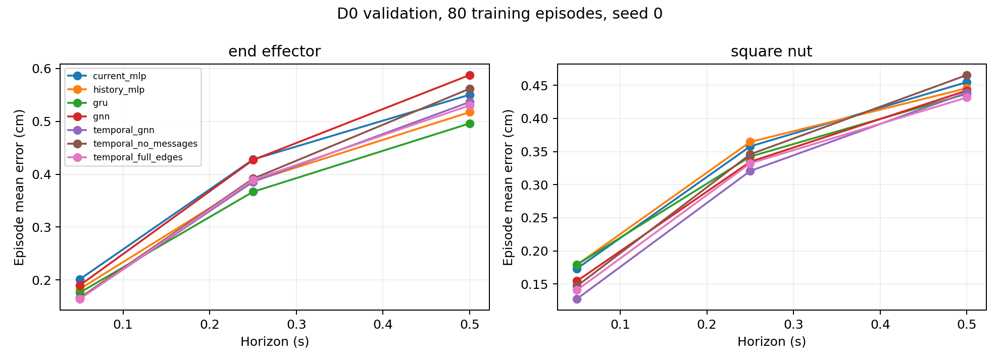
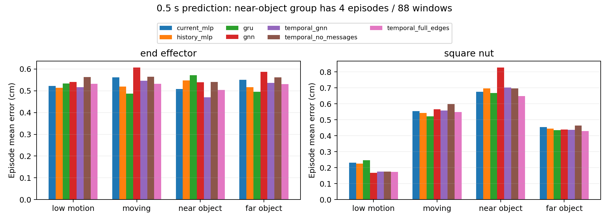
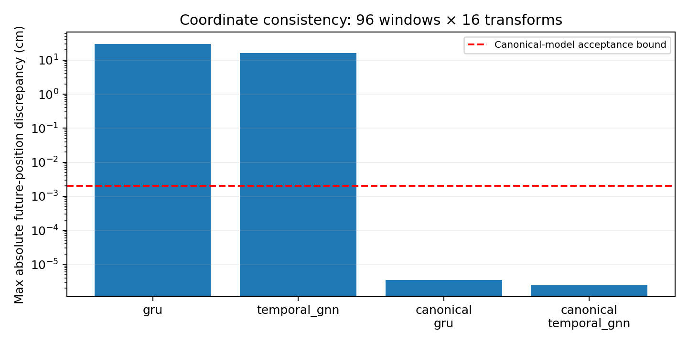
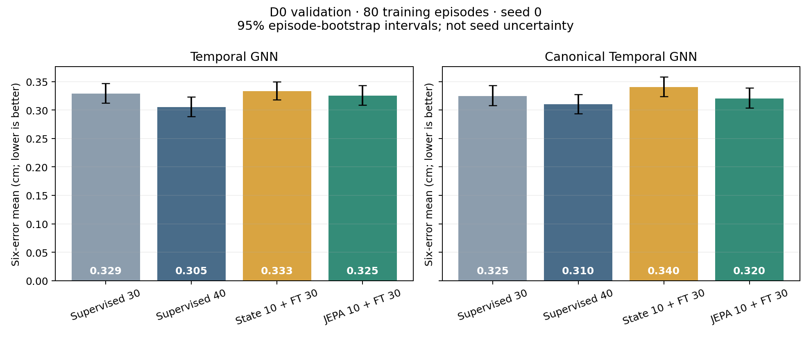
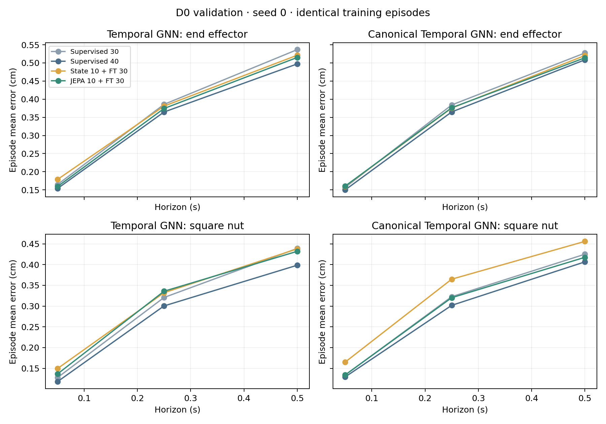

# Project progress, experimental results, and conclusions

Stages 0–7 are complete. Stage 8 is still running. This document summarizes the completed experiments and their limits. All accuracy figures below come from the archived D0 **validation pilots**, not the ongoing formal test matrix.

The main findings so far are:

- Temporal GNN is competitive with GRU, but its small overall improvement is accompanied by worse results in several moving-object and longer-horizon comparisons. A general graph advantage has not been established.
- Canonical-frame models satisfy the declared coordinate-equivariance checks. Their prediction accuracy is mixed, so coordinate consistency alone does not establish better generalization.
- JEPA beats the direct-state pretraining control in the completed pilots, but loses to 40 epochs of direct supervision in both graph architectures. The current evidence does not support an additional JEPA benefit at this budget.

## 1. Research task and evaluation protocol

The project studies action-conditioned prediction of robot and object motion in **MimicGen Square**, a Panda manipulation task involving a square nut and target peg. It asks whether graph structure, geometric equivariance, and predictive representation learning improve prediction accuracy, data efficiency, or generalization relative to simpler models.

Models receive four frames of observed state history and the planned action sequence through the requested horizon. Inputs retain end-effector and nut positions and orientations, gripper and robot joint state, peg/table geometry, and relative-position information. The outputs are future position changes for the end effector and nut. One horizon-conditioned model handles all three horizons; these are not three independently trained models.

| Protocol item | Current definition |
| --- | --- |
| Control frequency | 20 Hz |
| Prediction horizons | 1 / 5 / 10 steps, corresponding to 0.05 / 0.25 / 0.5 seconds |
| Main outputs | End-effector and nut position deltas |
| Error unit | Euclidean position error in cm; lower is better |
| Episode weighting | Average windows within an episode, then weight episodes equally |
| Overall score | Equal-weight mean of the two entities × three horizons |
| D0 split | 800 training / 100 validation / 100 test episodes; split seed 224 |
| Nested training subsets | 80 / 200 / 800 episodes |
| Completed learning pilots | 80 training episodes, 100 validation episodes, training seed 0 |
| Normalization | Fitted only on the training episodes available to each run |
| Formal training seeds | 0, 1, and 2 |

The learned models use planned future actions, not future observed states. Their performance should therefore be interpreted as action-conditioned prediction, not unconstrained forecasting. Hold and constant-velocity baselines ignore actions, so comparisons against those baselines do not isolate architecture alone.

The fixed split, model inputs, and evaluation rules are documented in the [experiment protocol](docs/experiment_protocol.md), [state-field specification](docs/state_fields.md), and [split manifest](reports/stage3/manifest.json).

## 2. Completed work

| Stage | Work completed | Evidence |
| --- | --- | --- |
| 0 | Repository structure, scope, and staged execution workflow | [README](README.md), [progress record](docs/progress.md) |
| 1 | Linux/CUDA environment, dependencies, simulation and numerical checks | [Environment report](reports/stage1/autodl/README.md) |
| 2 | D0/D1 data audit, numeric caches, coordinate recovery, and trajectory visualization | [Data report](reports/stage2/README.md) |
| 3 | Episode splits, nested subsets, causal windows, normalization, metrics, and non-learning baselines | [Baseline report](reports/stage3/README.md) |
| 4 | Current-state MLP, history MLP, and GRU; fitting, continuation, and validation pilots | [Learning report](reports/stage4/README.md) |
| 5 | Single-frame and temporal scene graphs; message-removal and full-edge controls | [Graph report](reports/stage5/README.md) |
| 6 | Canonical-frame Temporal GNN and GRU; complete prediction-chain coordinate tests | [Equivariance report](reports/stage6/README.md) |
| 7 | Regularized JEPA, direct-state pretraining, longer-supervision controls, and representation diagnostics | [Pretraining report](reports/stage7/README.md) |
| 8 | Protocol and execution pipeline verified; full formal matrix currently running | [Formal protocol](docs/formal_protocol.md), [launch record](reports/stage8/README.md) |

### Data quality and physical interpretation

Both distributions contain 1,000 episodes. D0 contains 153,477 recorded state/action rows and D1 contains 152,400. The audit read every episode, found no nonfinite numeric entries or inconsistent leading dimensions, and found no exactly duplicated state/action trajectories within or across the two files.

D0 and D1 use different object-observation layouts. The cache preserves the same physical meaning across them and recovers fixture geometry from each episode's simulator XML. D0 has a fixed peg; D1 varies the peg placement. Six complete trajectories, covering 905 states, passed simulator-state restoration checks. This validates state decoding; it does not imply that replaying the actions exactly reproduces every recorded transition.

The released files do not expose source-demonstration ancestry identifiers. Exact trajectory hashes therefore cannot rule out shared source demonstrations or related generated segments. D1 has been inspected for decoding and data integrity, but that inspection is distinct from evaluating prediction accuracy on D1.

## 3. Baselines: the task is learnable, but input information matters

The following results use the same 100 D0 validation episodes. Each entity column lists errors at **0.05 / 0.25 / 0.5 seconds**, in cm. Learned models use 30 training epochs here.

| Model | End effector | Nut |
| --- | --- | --- |
| Position hold | 0.715 / 3.344 / 6.242 | 0.490 / 2.313 / 4.309 |
| Constant velocity | 0.247 / 1.973 / 5.138 | 0.207 / 1.449 / 3.494 |
| Current-state MLP | 0.201 / 0.428 / 0.550 | 0.173 / 0.358 / 0.455 |
| History MLP | 0.183 / 0.387 / 0.518 | 0.179 / 0.365 / 0.446 |
| GRU | 0.176 / 0.367 / 0.496 | 0.179 / 0.342 / 0.437 |

Learning substantially reduces long-horizon errors relative to the two non-learning baselines. However, the learned models also receive the planned action sequence. The size of that improvement cannot be attributed solely to learning a better autonomous dynamics model.

Among the three learned non-graph baselines, GRU has the lowest six-error mean: **0.333 cm**, compared with **0.346 cm** for history MLP and **0.361 cm** for current-state MLP. This is a single-seed validation observation, not a definitive ranking across tasks or data regimes. Detailed intervals and training curves are in the [stage 4 report](reports/stage4/README.md).

## 4. Graph models: useful message passing, but no broad advantage yet

The scene graph has four nodes: end effector, nut, peg, and table. The default topology has ten directed edges, excluding the static peg–table pair. Temporal GNN performs spatial message passing for each history frame and then applies a per-node GRU. Orientation, gripper/joint state, fixture geometry, relative vectors, and planned actions are retained rather than reducing the scene to point positions alone.

All models in the table below use the same 80 training episodes, seed 0, and **30 epochs / 4,110 updates**. The overall score and 0.5-second errors are in cm.

| Model | Six-error mean | End effector at 0.5 s | Nut at 0.5 s |
| --- | ---: | ---: | ---: |
| Current-state MLP | 0.361 | 0.550 | 0.455 |
| History MLP | 0.346 | 0.518 | 0.446 |
| GRU | 0.333 | **0.496** | 0.437 |
| Single-frame GNN | 0.356 | 0.588 | 0.442 |
| Temporal GNN | **0.329** | 0.537 | 0.439 |
| Temporal GNN, messages closed | 0.346 | 0.562 | 0.465 |
| Temporal GNN, full edges | 0.331 | 0.530 | **0.432** |

*Figure 1. The overall mean hides differences between entities and horizons. Temporal GNN is strong on short-horizon nut prediction, while GRU is better on 0.5-second end-effector prediction. Source: [stage 5](reports/stage5/README.md).*

Temporal GNN improves the overall mean relative to GRU by about **0.004 cm**, but its 0.5-second end-effector error is worse by about **0.040 cm**. Closing messages raises the overall mean from 0.329 to 0.346 cm, which supports the usefulness of learned message passing within this architecture. Adding the static fixture edges produces 0.331 cm and does not improve the default graph overall.

The message-removal control still retains explicit relative-position features. It removes learned neighbor exchange, not all relational information. Its nominal parameter count is unchanged, but the disabled message network receives no gradient. This matters when interpreting the ablation.

### Motion and proximity groups

At 0.5 seconds, Temporal GNN predicts low-motion nut windows better than GRU, but performs worse on moving windows:

| Group | GRU | Temporal GNN | Messages closed |
| --- | ---: | ---: | ---: |
| Nut, low motion | 0.247 | 0.175 | 0.176 |
| Nut, moving | 0.522 | 0.558 | 0.598 |
| End effector, moving | 0.487 | 0.546 | 0.565 |

*Figure 2. Grouped 0.5-second validation errors. The near-object group contains only four episodes and 88 windows; proximity is not a contact annotation.*

Most of the low-motion nut advantage remains when messages are closed: 0.176 versus 0.175 cm. It cannot be credited solely to learned neighbor exchange. Conversely, messages improve moving-nut prediction relative to their removal, but the resulting model still trails GRU in that group.

These results support a limited statement: **the implemented graph model uses neighbor information and benefits from it in some comparisons**. They do not support the broader claim that graph structure is generally superior, or that it has demonstrated a contact-stage advantage.

## 5. Geometric equivariance: a verified property with mixed accuracy results

The implementation expresses inputs in the observed peg's coordinate frame, predicts local position deltas, and maps them back to world coordinates. This is known-frame **canonicalization**, not an EGNN message layer, and it adds no learned parameters. A canonical GRU provides a non-graph control.

The declared transformations are gravity-preserving yaw rotations and translations of the entire coordinate system. They do not represent independently moving the peg or nut, changing gravity, or executing a new physical rollout.

| Model, 30 epochs | Six-error mean, cm |
| --- | ---: |
| GRU | 0.333 |
| Canonical GRU | 0.347 |
| Temporal GNN | 0.329 |
| Canonical Temporal GNN | 0.325 |

Canonicalization slightly improves Temporal GNN in this pilot but worsens GRU. It is therefore not uniformly beneficial for prediction accuracy.

The complete prediction chain—including normalization, temporal processing, actions, and physical output decoding—was tested on **96 windows × 16 transformations**. Maximum absolute discrepancies were approximately **2.54 × 10⁻⁸ m** for canonical Temporal GNN and **3.47 × 10⁻⁸ m** for canonical GRU, below the declared **2 × 10⁻⁵ m** tolerance.

*Figure 3. Coordinate-consistency residuals on a logarithmic scale. The figure's vertical axis is in cm, whereas the numerical tolerances above are in meters. These residuals are not prediction errors on new physical trajectories.*

A separate D0 placement-coverage diagnostic found only five validation episodes outside the convex hull of the 80 training placements. It showed no consistent canonical-model advantage and is too small to support a strong extrapolation claim. Physical distribution-shift performance remains a question for the formal D1 evaluation. Details are in the [stage 6 report](reports/stage6/README.md).

## 6. JEPA: the longer-supervision control changes the conclusion

Stage 7 implemented an online encoder, an EMA target encoder, stop-gradient targets, causal future-history sampling, and full downstream fine-tuning. The objective includes fixed variance and covariance penalties to discourage collapse. It is a **regularized JEPA adaptation for numeric state/action data**, not a reproduction of image I-JEPA.

Two controls are essential to the comparison:

- **Direct-state pretraining:** predict 132 physical values from the future history, then discard the auxiliary head and fine-tune the physical predictor.
- **Longer direct supervision:** train the physical prediction task continuously for 40 epochs.

JEPA and state pretraining use 10 pretraining epochs plus 30 fine-tuning epochs. Their physical heads and optimizers are reset at the phase boundary. All six new runs make **5,480 updates**, use the same context-window order, and select checkpoints from the final 30 epochs. Pretraining uses no extra episodes. These budgets match updates and context presentations, not exact FLOPs.

| Training protocol | Ordinary Temporal GNN | Canonical Temporal GNN |
| --- | ---: | ---: |
| Supervised 30 epochs, earlier reference | 0.3290 | 0.3249 |
| Supervised 40 epochs | **0.3054** | **0.3102** |
| State pretraining 10 + fine-tuning 30 | 0.3334 | 0.3403 |
| JEPA 10 + fine-tuning 30 | 0.3254 | 0.3205 |

*Figure 4. Six-error means in cm with 95% episode-bootstrap intervals. The intervals describe validation-episode variation for seed 0, not uncertainty across training seeds. The 30-epoch models are lower-budget references.*

JEPA appears slightly better if compared only with the older 30-epoch supervised models. The 40-epoch control reverses that interpretation: **direct supervision is better in both architectures and on all six entity/horizon means within each architecture**. Relative to this control, JEPA's overall error is about 6.6% higher for ordinary Temporal GNN and 3.3% higher for canonical Temporal GNN.

Paired comparisons use the same validation episodes and 2,000 bootstrap resamples. Negative differences favor JEPA.

| Architecture | JEPA minus control | Difference, cm | 95% episode-bootstrap interval |
| --- | --- | ---: | --- |
| Ordinary | State pretraining | −0.0080 | [−0.0118, −0.0041] |
| Ordinary | Supervised 40 | +0.0200 | [+0.0166, +0.0236] |
| Canonical | State pretraining | −0.0198 | [−0.0234, −0.0159] |
| Canonical | Supervised 40 | +0.0103 | [+0.0065, +0.0144] |

*Figure 5. The longer-supervision advantage is present across both entities and all three horizons, rather than arising only from the aggregate score.*

### Does the negative JEPA result come from a broken training path?

The checks performed so far do not point to that explanation:

- Both variants pass the declared collapse screen on raw online/target latents and layer-normalized target/predictor outputs, evaluated separately for each dynamic node.
- Normalized target effective ranks are approximately 12–15, and normalized predictor ranks approximately 11–14, above the screening threshold of 2.
- Tests verify online-encoder gradients, target stop-gradient behavior, and the EMA update. Future observations enter the training target branch rather than downstream inference inputs.
- Removing actions or permuting past history changes the physical predictions and increases diagnostic-subset errors. The models are not simply ignoring those inputs.
- Independent reloads reproduce predictions exactly. Canonical variants retain their full-chain coordinate property, with maximum discrepancies below 4 × 10⁻⁸ m after the new training protocols.

These checks rule out the specific failures tested; they do not prove that the representation or optimization settings are optimal. The supported conclusion is that **this JEPA configuration does not add value over longer direct supervision at the measured budget**, not that JEPA can never help dynamics prediction. See the [full pretraining report](reports/stage7/README.md).

## 7. Reliability, reproducibility, and measured cost

The current Linux suite has **48 passing tests**. Windows passes 30 base tests, with eight skip entries for unavailable torch/PyG coverage. CUDA behavior is verified on AutoDL rather than inferred from the Windows checks.

Reproducibility checks cover episode splits, training-only normalization, causal sampling, finite losses/gradients, source and data hashes, checkpoint compatibility, model reloads, and coordinate transformations. All eight architecture/method combinations used by the formal pipeline pass interruption/resume checks, including the pretraining-to-fine-tuning boundary and final result generation from an already completed checkpoint. Duplicate queue launches are rejected; replaying a completed queue preserves its selected checkpoints and training metrics.

The implementation and small fitting tests are separate from scientific evidence. In particular, the two-episode workflow results under `reports/stage8/workflow_check_final` test the execution/reporting path; they are **not formal test results** and are not included in the accuracy comparisons above.

| Completed workload | Observed cost |
| --- | --- |
| Three non-graph, 30-epoch pilots | About 159 s of measured run time, plus 26 s input preparation |
| Four graph, 30-epoch pilots | About 12.6 minutes of measured run time, plus 34 s input preparation |
| Two canonical-frame, 30-epoch pilots | About 6 minutes of measured run time, plus 18 s input preparation |
| Six pretraining/supervision pilots | About 25.5 minutes of measured run time, plus 65.2 s input preparation |
| Full-data resource probe: canonical JEPA, 800 episodes | About 72.7 s per pretraining epoch and 63.2 s per fine-tuning epoch; 1.15 GiB peak allocated CUDA memory |

These are measured costs on the existing RTX 4090 D, not isolated hardware benchmarks. Other work and diagnostic workloads varied across measurements. JEPA used about 4.9% more update time than supervised 40 in the ordinary architecture and 3.9% more in the canonical architecture; its weaker result cannot be explained by receiving less measured update time in those pilots.

Raw data, model checkpoints, and local environments are excluded from Git. The repository contains configurations, source/data/checkpoint hashes, episode-level metrics, verification records, and small figures. Checkpoints remain on AutoDL. The [stage 8 verification record](reports/stage8/verification.json) documents the latest pipeline checks; each earlier stage report links its own artifacts.

## 8. Formal experiments currently running

The formal queue was launched from commit `94fb2b9` on November 11, 2026, at **11:26 PST**. The runtime check used for this summary found the queue still training: its first configuration had completed, and ordinary Temporal GNN with JEPA, 80 episodes, seed 0 was active. This is a dated status snapshot, not a live completion counter. Partial formal-run metrics are not used here to revise the pilot conclusions.

| Component | Coverage | Configurations |
| --- | --- | ---: |
| Core comparison | Ordinary/canonical Temporal GNN × supervised/JEPA × 80/200/800 episodes × 3 seeds | 36 |
| Non-graph controls | History MLP/GRU × 80/200/800 episodes × 3 seeds | 18 |
| Direct-state pretraining controls | Ordinary/canonical Temporal GNN × 80 episodes × 3 seeds | 6 |
| Total | All configurations run afresh | **60** |

The 60 configurations contain **84 training phases** because JEPA and state pretraining each include pretraining and fine-tuning. Hold and constant velocity require no training. Learned and non-learning predictors will together produce **124 prediction sets** across held-out D0 and D1.

The pipeline first finishes every training run and independently reproduces its validation predictions. It then seals the selected checkpoint hashes before opening test evaluation. D0 test and D1 cannot select checkpoints or alter the frozen configuration. The script also performs representation and coordinate diagnostics, retains every seed, and generates episode tables, paired comparisons, data-efficiency plots, horizon plots, and cost plots.

The job uses `nohup setsid`, checkpoint recovery, and duplicate-run locks. SSH disconnection was tested after launch and did not stop training. It has no automatic wall-time kill and is estimated at roughly 12–16 hours plus variable system/I/O overhead. The instance must remain running; platform or machine failures can still interrupt execution.

The [formal protocol](docs/formal_protocol.md) contains the full commands and test-use rules. On AutoDL, paths relative to `/root/autodl-tmp/RobotDynamics-CS224W-Stanford` are:

| Purpose | Path |
| --- | --- |
| Driver log | `outputs/stage8/formal_driver.log` |
| Live queue state | `outputs/stage8/formal/progress.json` |
| Completion code | `outputs/stage8/formal/pipeline.exit` |
| Generated report and figures | `outputs/stage8/formal/analysis/` |

An exit code of `0` means the script reached its end. Scientific acceptance still requires inspecting diagnostic flags, completeness, seed variation, and result provenance. Stage 8 remains open until that review and publication are complete.

## 9. What can and cannot be concluded now

| Question | Evidence available now | Conclusion still pending |
| --- | --- | --- |
| Can these models fit and predict the recorded task? | Small-sample fits, valid gradients, and low D0 validation errors | Robust performance across seeds and physical distribution shifts |
| Does graph structure help? | Messages help the tested temporal graph; overall error is close to GRU | A consistent advantage over equally budgeted non-graph models |
| Does canonicalization provide equivariance? | Complete prediction-chain yaw/translation checks pass | Better physical OOD accuracy or data efficiency |
| Does JEPA add value? | It beats state pretraining, but loses to longer supervision in both architectures | Benefits at other data fractions or under D1 shift |
| Are interaction-specific gains demonstrated? | Limited motion-group differences; a sparse proximity group | A credible contact-stage or grasp-stage advantage |
| Does low offline error imply better control? | No closed-loop experiment has been run | Control success, stability, and task completion benefits |

The completed pilots use one training seed and a validation set that also selects checkpoints. Their bootstrap intervals do not measure seed variance or remove selection bias. Many selected checkpoints lie near the end of the training budget, so the comparisons are budget-limited rather than claims about fully converged, optimally tuned models. The 40-epoch graph results also cannot establish superiority over the earlier 30-epoch GRU without matching that training budget; the formal queue supplies the required controls.

The next evidence to examine is the complete formal matrix: all seeds, all prescribed data fractions, held-out D0, and D1. The interpretation should follow those results, including negative outcomes and failed diagnostics. No robustness extension, new task, closed-loop evaluation, or stage 9 work has started.
