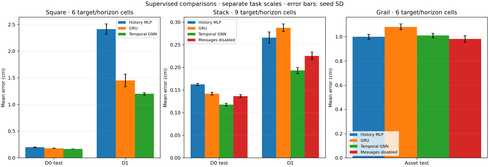
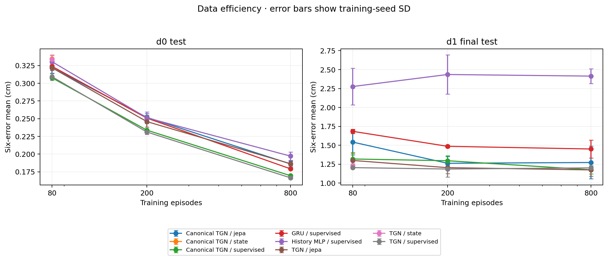
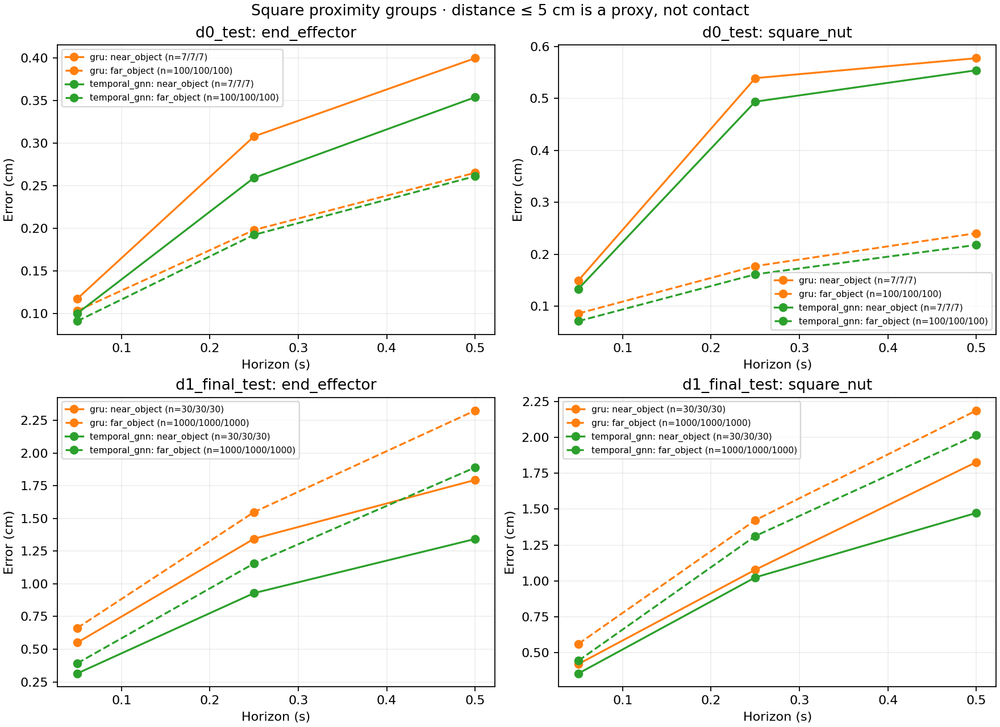
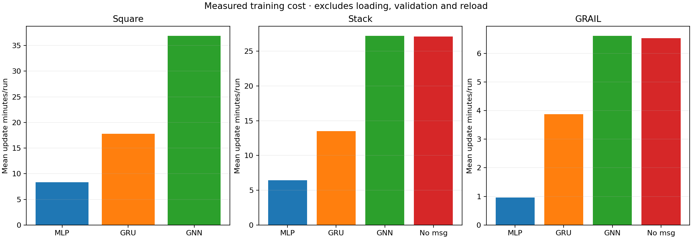

# Graph prediction of robot and object motion

Supervised Temporal GNN predicts recorded manipulation motion more accurately than the tested MLP and GRU controls on MimicGen Square and Stack. The improvement survives three training seeds and the tested D1 distribution shifts. It does not extend uniformly to the separate GRAIL task: there, the graph model improves over GRU but fails to improve over MLP or its own message-ablation control. Geometric canonicalization and JEPA do not provide consistent additional accuracy gains on Square.

The experiments answer a narrower question than whether graphs are universally better for robotics. They compare fixed architectures, inputs and training budgets on offline position forecasting. They do not measure closed-loop control, contact prediction or task success.

## What was compared

Square and Stack use four observed state frames and the planned action sequence to predict position changes at 0.05, 0.25 and 0.5 s. Square's graph contains the end effector, nut, peg and table. Stack replaces the nut/peg pair with two cubes. Nodes carry positions, rotations and typed robot/fixture features; relative positions enter messages. MLP and GRU receive equivalent physical information. Static fixtures condition prediction but are excluded from the main error metric.

Square uses 800/100/100 D0 train/validation/test episodes, with nested 80/200/800 training subsets, and all 1,000 D1 episodes for distribution-shift evaluation. Stack uses 800 training episodes and the same 100/100 D0 validation/test sizes, plus 1,000 D1 episodes. Each model configuration uses three training seeds. Every reported score weights episodes, entities and horizons equally; units are cm. Square averages six entity/horizon cells and Stack nine.

GRAIL is a separate history-only experiment with no executable future action input. Its 240 motions come from 120 assets; asset-disjoint training/validation/test splits contain 168/36/36 motions. Eight observed frames predict root/object displacement at 0.04, 0.24 and 0.48 s. Models are trained from scratch. This demonstrates the abstraction on another dataset, not pretrained or zero-shot transfer.

The protocols were fixed before held-out evaluation. Forty-epoch configurations select the lowest validation error within epochs 11–40; all selections are sealed before test predictions. Normalization uses training data only. All seeds and the non-learning baselines are retained. Parameter counts, optimizer steps and measured costs accompany the accuracy results. Matching epochs and input information does not mean matching FLOPs or wall time.

## Main results

The table shows full-training-data seed means; uncertainties, all fractions and baselines are in the [generated tables](figures/tables.md). Lower is better. Scores from different tasks should not be pooled.

| Model | Square D0 | Square D1 | Stack D0 | Stack D1 | GRAIL asset test |
| --- | ---: | ---: | ---: | ---: | ---: |
| History MLP | 0.1972 | 2.4142 | 0.1622 | 0.2655 | 1.0001 |
| GRU | 0.1792 | 1.4505 | 0.1419 | 0.2875 | 1.0825 |
| Temporal GNN | 0.1665 | 1.2010 | 0.1175 | 0.1929 | 1.0109 |
| Messages disabled | Not in formal matrix | Not in formal matrix | 0.1362 | 0.2254 | 0.9823 |

On Square, ordinary supervised GNN improves over GRU by 7.1% on D0 and 17.2% on D1 at 800 training episodes. It beats the MLP/GRU controls at every tested fraction on both distributions, with all three seeds agreeing in direction. D1 errors are still much larger than D0 errors. Constant velocity remains better at the shortest D1 horizon, so the aggregate result should not be read as a win in every individual condition. The formal Square matrix does not include a message-removal control; its earlier single-seed ablation was a validation pilot.

On Stack, GNN improves over GRU by 17.2%/32.9% and over messages disabled by 13.7%/14.4% on D0/D1. Every seed favors GNN in these aggregate comparisons. The ablation preserves nominal parameters and message computation but zeros exchanged messages, so this is stronger evidence that learned neighbor exchange helps under this protocol. Explicit relative-coordinate features remain available to both variants. Position hold still beats learned models on the more stationary cube B at every horizon.

On GRAIL, GNN improves over GRU by 6.6%, but its mean is 1.1% worse than MLP and 2.9% worse than messages disabled. Joint seed/asset 95% intervals for GNN minus control are −0.1114 to −0.0299 cm against GRU, −0.0319 to +0.0485 against MLP, and −0.0025 to +0.0576 against messages disabled. The latter two cross zero. This supports the comparison with this GRU configuration, while providing no overall evidence of benefit from messages. Only 18 test assets and three seeds are available, so the bootstrap intervals are approximate and descriptive.

## Data efficiency, geometry and pretraining

The Square matrix compares ordinary and canonical Temporal GNN, each with supervision and JEPA, across all three data fractions. A direct-state pretraining control is included at 80 episodes only. Pretraining uses the same training subset as supervision: it adds no external data. JEPA and state pretraining receive 10 pretraining epochs plus 30 fine-tuning epochs, while the supervised controls receive 40 epochs.

JEPA does not consistently improve over longer supervision. It worsens D0 results across the tested fractions. Some D1 means improve, but the gains vary by seed and their paired intervals include zero. The collapse screens pass; that verifies the declared representation-health checks, not downstream usefulness. The small-data state-pretraining comparison also does not justify a broad claim that latent prediction is superior to direct supervision.

Canonical models pass the full-chain gravity-preserving yaw/translation checks, but this coordinate property does not establish better physical generalization. At full data, canonical GNN has a slightly smaller D1 mean than ordinary GNN (1.1754 versus 1.2010 cm), with uncertainty that includes no gain, and a worse D0 mean (0.1696 versus 0.1665 cm). The implementation uses canonical coordinates rather than an EGNN layer. Both the geometric consistency result and the mixed prediction result belong in the conclusion.

## Horizons, proximity and cost

The full [Square horizon figure](figures/square/horizons.png), [Stack horizon figure](figures/stack/horizons.png) and [GRAIL horizon figure](figures/grail/horizons.png) preserve the entity-level comparisons. Short-horizon motion can favor simple extrapolation; stationary objects can favor position hold. An aggregate score alone hides these cases.

The near-object group uses current end-effector/nut distance at most 5 cm. It is a proximity proxy, not a contact label. Only seven D0 test episodes and 30 D1 episodes contribute to the near group, versus 100 and 1,000 to the far group; the same episode can contribute windows to both. These small subsets cannot support a claim about contact dynamics or successful insertion. The archived group tables also report past-speed groups and population counts.

At 800 Square episodes, mean update times are 8.36 minutes for MLP, 17.81 for GRU and 36.90 for GNN. GNN's lower error therefore comes at about twice GRU's measured update cost. On GRAIL the ratio is about 1.71. Parameter counts are similar but effective capacity and arithmetic are not identical. These times exclude loading, validation and reload; the hardware and workload were not controlled as a cross-platform speed benchmark. All 84 learned-run costs are retained in [all_costs.csv](figures/all_costs.csv).

## Failure cases and limits

All six GRAIL graph configurations select epoch 11, the earliest allowed checkpoint, while their validation minima occur earlier. The [curves](figures/grail/learning_curves.png) show deterioration with continued training. This is a fixed-recipe comparison, not an architecture-specific tuning study. No checkpoint was reselected after examining test results; earlier selection would require a new experiment and cannot be assumed to restore a message advantage.

The [four predetermined GRAIL examples](../stage9/grail/README.md#predetermined-trajectory-examples) show lag around abrupt object movement and overshoot from constant velocity. The root/object/table graph omits wrist Cartesian anchors, mesh geometry and contact labels. Those omissions are plausible limits of the representation, but their causal contribution to the result was not tested. Every plotted point is a direct forecast from an observed history, not a free-running rollout.

There are only three training seeds. The reported paired bootstrap intervals do not include a multiple-comparison correction. Demonstration ancestry beyond the available release identifiers is not fully observable. Square/Stack D1 evaluates a specified distribution shift, not unrestricted real-world generalization. All formal test sets are now used tests; additional test-inspired development must be labeled exploratory.

## Reproduction and delivery checks

The [reproduction guide](../../docs/reproduction.md) provides installation, pinned data acquisition, decoding, training, loading, plotting, recovery and formal-checkpoint access information. The [Colab notebook](../../notebooks/robot_dynamics_demo.ipynb) runs an eight-training/two-validation Square example with the research graph implementation and five training epochs. It creates its own checkpoint; formal weights are retained on AutoDL rather than offered as public downloads.

The notebook was executed sequentially in a fresh Windows CPU environment and separate clean source checkout. All eight code cells completed, and independent checkpoint evaluation reproduced the validation prediction hash exactly. Installation and initial cache construction were run separately before notebook execution. [Execution metadata](notebook_execution.json) records that distinction. The hosted Colab interface was not executed. Both Linux and the fresh Windows CPU environment pass 63 tests. The [combined validation record](validation.json), [Linux tests](tests.txt), [CPU tests](cpu_tests.txt), [dependency check](cpu_dependencies.txt), [lint](lint.txt) and [format check](format.txt) record their scope. An initial test-discovery collision with the nested reproduction checkout was fixed by restricting collection to `tests/`; the final suite passes. A [two-epoch interruption/resume check](resume_verification.json) also matches the uninterrupted five-epoch predictions. A separate replay of GRAIL's formal seed-0 GNN reproduces its complete held-out error-array hash exactly.

The small example's [scene graph](demo/graph.png), [trajectory](demo/trajectory.png), [verification](demo/verification.json), normalizer and metrics are archived separately from the formal evidence. Five-epoch demonstration errors should not be substituted into the main results table. The original data and model weights remain outside git.

The final exporter reads the three archived analyses and writes 62 summary rows, 84 cost rows and source hashes. It also reaggregates GRAIL episode errors and checks exact agreement. [provenance.json](figures/provenance.json) identifies its inputs. The earlier [Square audit](../stage8/formal/final_verification.json), [Stack audit](../stage9/final_verification.json) and [GRAIL audit](../stage9/grail/final_verification.json) retain the broader full-prediction and numerical checks. The original Square/Stack server was unavailable for another Stage 10 replay; their prior checks were not relabeled as new ones.

Stage 10 delivers the reproduction example, code and final report materials. No new formal matrix, architecture search, closed-loop experiment or blog publication was started.
