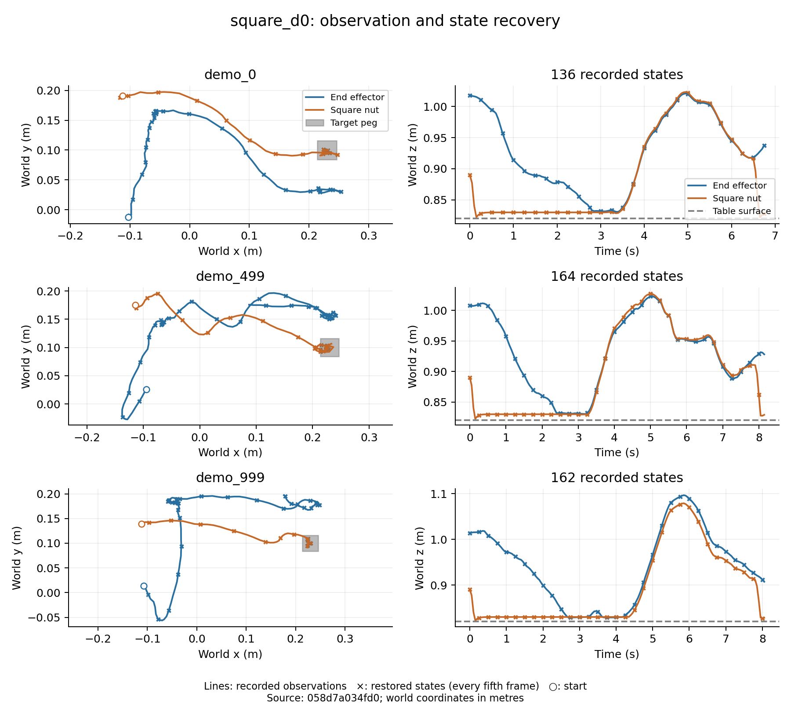
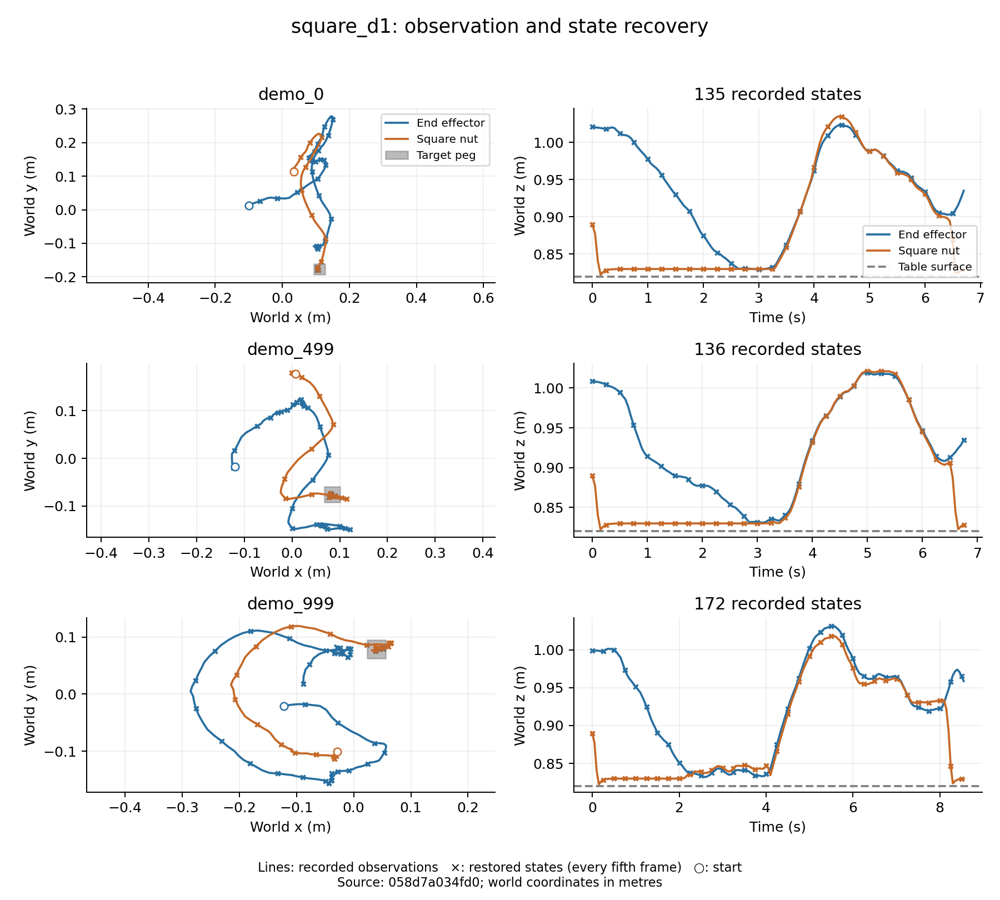

# Square data audit

The core Square D0/D1 release contains enough numeric observations for state prediction. Fixture poses must be recovered separately for each D1 episode. This report covers data validation and recovery, not prediction accuracy or model training.

## Source and coverage

The files came from `amandlek/mimicgen_datasets`, revision `33016f8a62c02334f929f2913af8fdd2a8a129e1`. Both sizes and SHA-256 values match the upstream LFS metadata. The [download manifest](source.json) records the exact files. The full scan and cache extraction used a clean checkout of `36fcf0bbc071591a5fa9402e3bd2f9e9f70a9384`.

| Quantity | D0 | D1 |
| --- | ---: | ---: |
| Episodes | 1,000 | 1,000 |
| Recorded state/action rows | 153,477 | 152,400 |
| Observed one-step transitions | 152,477 | 151,400 |
| Length: min / Q1 / median / Q3 / max | 135 / 139 / 156 / 166 / 172 | 135 / 139 / 156 / 164 / 172 |
| Action dimensions | 7 | 7 |
| Object observation dimensions | 14 | 17 |
| Distinct episode XML files | 1 | 1,000 |

Every array in every episode was read, including both camera streams. Recorded counts agree with the HDF5 metadata. Each distribution has one consistent schema, no nonfinite numeric entries, and no mismatched leading dimensions. No exact duplicate state/action trajectory was found within either file. Per-episode lengths, XML hashes, trajectory hashes, and timestep extrema are retained in [D0](square_d0_episodes.csv) and [D1](square_d1_episodes.csv) tables. Detailed field ranges and environment metadata are in the [D0](square_d0.json) and [D1](square_d1.json) summaries.

The [cross-file check](cross_distribution.json) also found no identical state/action trajectories between D0 and D1. The released files contain no source-demonstration ancestry identifiers. Exact trajectory hashes cannot rule out shared source demonstrations or related generated segments. That limitation matters when interpreting future held-out results. D1 inspection here is limited to decoding and data integrity; no D1 prediction result has been used for model selection.

## Interpretation

Both environments use Panda with delta OSC_POSE at 20 Hz. Recorded timestamps advance by 0.05 s; 0.25 s and 0.5 s therefore mean 5 and 10 actions. Action values stay in [-1, 1]. Translation targets scale by 0.05 m, rotation increments by 0.5 rad, and the last component opens or closes the gripper. Commands are not measured next-frame displacements.

The D0 `object` vector contains nut pose and its pose relative to the end effector. D1 appends the target peg position. The decoder preserves the nut's physical meaning across both layouts and composes fixture transforms from episode XML. It checks D1's appended peg coordinates against that recovered pose throughout every trajectory. The [field table](../../docs/state_fields.md) explains units, frames, orientation references, and controller semantics.

The files contain `states`, `actions`, and `obs`, but no `next_obs`. The final action of each episode has no recorded successor state and is excluded from the observed transition count. No terminal state is duplicated or simulated to fill that gap. Recorded rewards and done flags refer to post-transition outcomes and are not current inputs. No future-derived velocity, normalization, split, or window has been added.

Range inspection found task-scale coordinates rather than a unit mismatch. Nut height spans 0.82094–1.12394 m across both files, above a table surface at 0.82 m. D0's target peg is fixed at (0.23, 0.10, 0.85) m; D1 peg x spans −0.09955–0.29832 m and y spans −0.19813–0.19983 m. Finger joint positions do slightly exceed the model's nominal [0, 0.04] and [−0.04, 0] m ranges: the combined extrema are [−0.000489, 0.042758] and [−0.041795, 0.000813] m. These simulator observations are retained without clipping; the cache does not assume hard joint bounds. Some trajectories also reach beyond the table footprint. Those coordinates are reported rather than silently discarded.

## Recovery and plots

Verification uses the same three index-selected episodes in each distribution: `demo_0`, `demo_499`, and `demo_999`. Every saved state in these episodes is restored using its own model XML. The checks compare observations, world poses, joint positions, and fixture geometry with MuJoCo. A separate first-20-action replay is a diagnostic; its outputs are never substituted for labels.

All six trajectories passed, covering 462 D0 and 443 D1 states. Position, finger-coordinate, and arm-joint differences were zero. The largest world rotation-matrix difference was `6.66e-16`; the original `object` vector differed by at most `3.58e-7` in its relative pose components. The [D0 restoration record](square_d0_restoration.json) and [D1 restoration record](square_d1_restoration.json) come from clean commit `058d7a034fd03c2ab225afcef6ed7acdd84572e7`. The same commit generated the figures and summaries. This revision forwards MuJoCo after each replay step so the pose readout corresponds to the updated state.

The short replays are not exact reproductions of the recorded dynamics. The table below measures end-effector differences after the first 20 actions, with a fresh initial restore. Each row corresponds to one diagnostic replay, not an aggregate prediction benchmark.

| Distribution / episode | Mean difference to next recorded frame (cm) | Maximum (cm) | Mean difference to unadvanced frame (cm) |
| --- | ---: | ---: | ---: |
| D0 / 0 | 0.364 | 0.380 | 1.099 |
| D0 / 499 | 0.652 | 0.691 | 0.969 |
| D0 / 999 | 0.361 | 0.390 | 1.091 |
| D1 / 0 | 0.384 | 0.452 | 1.118 |
| D1 / 499 | 0.490 | 0.536 | 1.249 |
| D1 / 999 | 0.797 | 0.882 | 1.415 |

The next-frame comparison is closer in all six cases, consistent with the upstream indexing contract. Saved states omit solver and controller history, but this check does not isolate the cause of the remaining replay discrepancy. The audit validates recorded-state extraction and timing; it does not certify exact action-based dynamic reproduction.

Lines are recorded positions and crosses are restored positions sampled every fifth frame. Open circles mark starting positions. The peg footprint and table height provide geometric context. These are state-recovery plots, not model predictions. No image-rendering benchmark or closed-loop evaluation was performed.

## Reproduction and limits

Follow [data processing](../../docs/data_processing.md) for the exact download, audit, extraction, verification, plot, and summary commands. Raw data and numeric caches are stored under `/root/autodl-fs/RobotDynamics-CS224W-Stanford-data`; complete scan logs and JSON are under `outputs/stage2` in the AutoDL checkout. Cache metadata records its input checksum, code commit, frame, timestep, and completion flag. Raw data and caches are excluded from Git.

The numeric caches are 133,193,399 bytes (D0) and 132,726,694 bytes (D1); their checksums are in the summaries. [Seventeen tests passed](tests_final.txt) on AutoDL, along with [Ruff](ruff_final.txt), [formatting](format_final.txt), and the [audited configuration check](config.json). Source-level tests cover nonfinite values, timestamp gaps, layout mismatches, nested fixture transforms, dynamic-fixture rejection, and quaternion conversion. The simulation logs are retained for [D0](square_d0_final.log) and [D1](square_d1_final.log).

Development checks caught two decoder assumptions: MuJoCo omits the default `group="0"` attribute in saved XML, and the end-effector quaternion refers to the hand body rather than the grip site. Both were corrected before the reported extraction. Relative pose observations show small float32-level recovery differences; canonical world rotations use float64 matrices.

No model has been trained and no prediction metric is available. The next stage will create episode splits, causal windows, and non-learning baselines. Formal training and final-test evaluation remain separate work.
