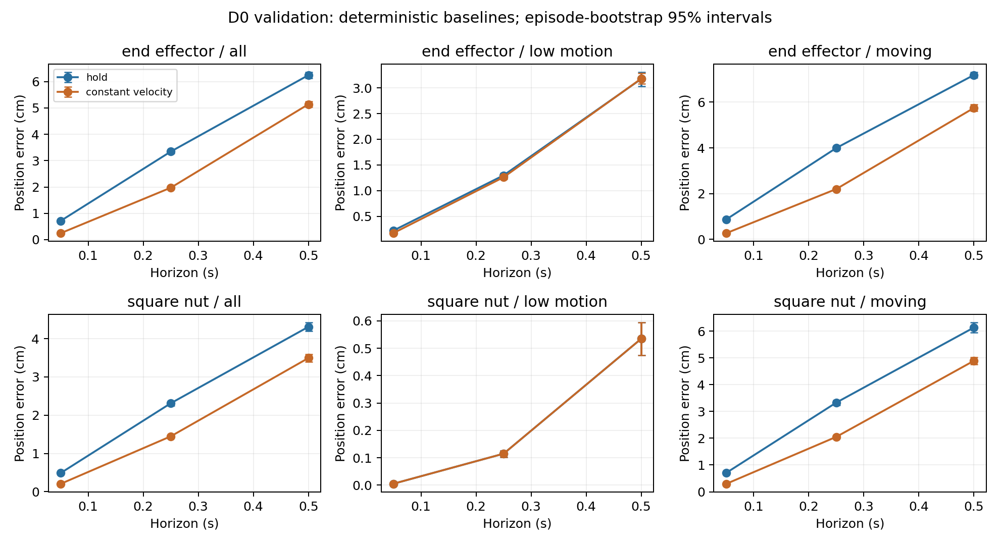
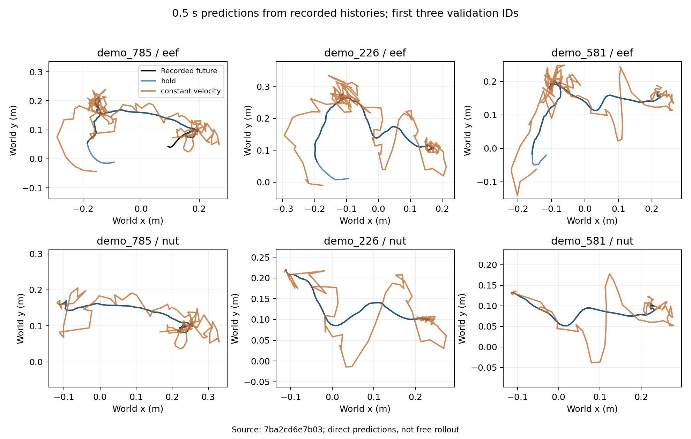

# Position baselines on D0 validation

Constant velocity improves the overall error over position hold at all three horizons. The advantage is largest at one step and shrinks at 0.5 s. Low-motion segments tell a different story: both methods are nearly identical for a settled nut, and neither reliably predicts when motion will start. These are deterministic baselines on validation data, not learned-model or final-test results.

## Data and protocol

Source commit: `7ba2cd6e7b03d998080330f34f3df66adda18c3a`, with a clean working tree. The [manifest](manifest.json) fixes D0 train/validation/test to 800/100/100 episodes using seed 224, with nested 80/200/800 training subsets. D1's 1,000 episodes are listed only as a reserved final-test set. Neither D0 test nor D1 prediction errors were evaluated.

The 100 validation episodes contain 15,238 recorded states. With four history frames, the 1/5/10-step horizons yield 14,838 / 14,438 / 13,938 windows respectively. Both baselines use identical anchors and ignore available planned actions. The final action without a recorded successor has no label. All normalization statistics and motion thresholds come from training episodes; the [normalizers](normalization.json) record their exact episode IDs. Baseline predictions themselves use metres and do not need normalization.

For each entity, errors are Euclidean distances in cm, averaged within each episode and then equally across episodes. Intervals bootstrap episodes 2,000 times with seed 224. These methods have no optimizer, checkpoint, or training seed; rerunning identical deterministic models three times would not estimate training variability. Full settings, hashes, counts, intervals, and paired method differences are in [metrics.json](evaluation/metrics.json), with [summary CSV](summary.csv) and [episode CSV](evaluation/episodes.csv).

## Overall results

Each entry is mean error with a 95% episode-bootstrap interval, in cm.

| Entity | Horizon | Position hold | Constant velocity |
| --- | --- | ---: | ---: |
| End effector | 0.05 s | 0.715 [0.703, 0.728] | 0.247 [0.243, 0.251] |
| End effector | 0.25 s | 3.344 [3.280, 3.407] | 1.973 [1.935, 2.012] |
| End effector | 0.50 s | 6.242 [6.117, 6.363] | 5.138 [5.028, 5.250] |
| Square nut | 0.05 s | 0.490 [0.478, 0.501] | 0.207 [0.203, 0.212] |
| Square nut | 0.25 s | 2.313 [2.254, 2.369] | 1.449 [1.411, 1.486] |
| Square nut | 0.50 s | 4.309 [4.194, 4.417] | 3.494 [3.396, 3.594] |

Low-motion labels use only the past one-step speed. The full training pool gives thresholds of 0.063402 m/s for the end effector and 0.000001 m/s for the nut (the numerical floor). These are entity-specific recent-motion proxies, not identical physical definitions of stationary motion and not contact labels. Every reported segment is represented in all 100 validation episodes.

At 0.5 s, low-motion end-effector errors are 3.175 cm for hold and 3.182 cm for constant velocity. For the nut they are both about 0.5345 cm. A low past speed does not guarantee a stationary future, which explains why these groups still have nonzero longer-horizon errors. Moving-segment errors at 0.5 s are 7.190 versus 5.749 cm for the end effector and 6.135 versus 4.892 cm for the nut. Reporting only the overall nut error would conceal the easier settled portions. Static peg and table nodes are excluded from every primary error.

Constant velocity remains a useful comparator for subsequent models. No smoothing, horizon-dependent tuning, difficult-window removal, or action-conditioned correction was added after seeing these results. Contact-phase performance remains unmeasured because no trustworthy contact labels have been established.

## Example predictions

The examples are the first three validation IDs in manifest order (`demo_785`, `demo_226`, `demo_581`), not selected by prediction error. Curves connect predictions from successive recorded histories; they are not free rollouts. Position-hold paths can overlap the recorded spatial path while remaining temporally delayed. Constant velocity extrapolates bends and sudden speed changes, producing visible overshoot at 0.5 s. The error table compares matching timestamps and uses all three position coordinates, while these plots show the xy projection.

## Checks, cost, and reproduction

- [25 tests passed](tests.txt), including split overlap, nested subsets, window boundaries, future-state isolation, unit conversion, training-only statistics, and equal episode weighting.
- The evaluator checked 600 real first/last windows: 100 validation episodes × 3 horizons × 2 boundaries. Action slices and inverse-scaled targets agreed with their source arrays.
- [Ruff](ruff.txt) and [formatting](format.txt) passed. A second evaluation produced identical episode CSV bytes and summary values; see [reproducibility.json](reproducibility.json).
- Fitting all three normalizers took 1.779 s and peaked at 144.7 MiB RSS. Evaluation took 1.343 s and peaked at 69.2 MiB RSS. These measurements include Python startup, cache hashing, and the corresponding command; plotting, copying the cache, and tests are excluded. Measurements used Python wall-clock timing and Linux child-process resource accounting because `/usr/bin/time` was absent. [Normalization resources](normalization_resources.json), [evaluation resources](evaluation_resources.json).

The run used AutoDL CPU and a local-disk copy of the audited numeric cache; no GPU computation was used. Shared-machine timing is an observed cost, not a hardware-independent guarantee. Follow the [baseline protocol and commands](../../docs/baseline_protocol.md). Use this committed manifest and normalizer for subsequent comparisons; regenerate statistics only when intentionally changing the training subset.

No learning model was trained. The next stage is the MLP/GRU training pipeline and small-scale fitting checks, with checkpoint recovery and validation-based selection. Test sets remain held out.
