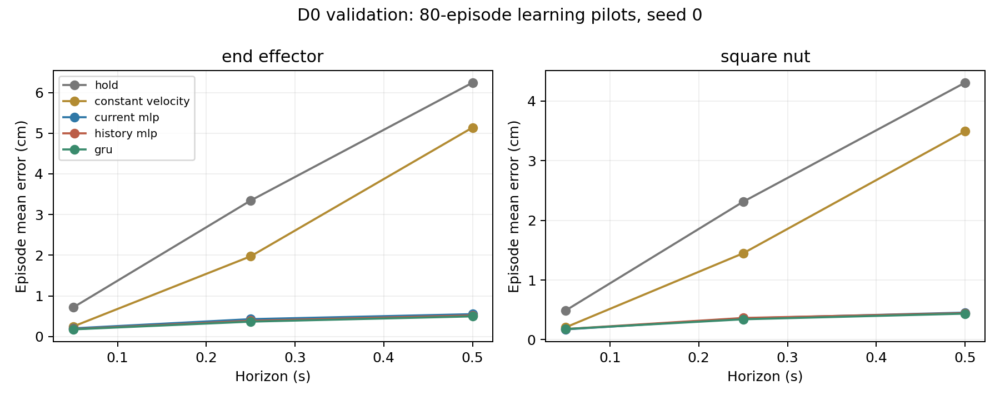
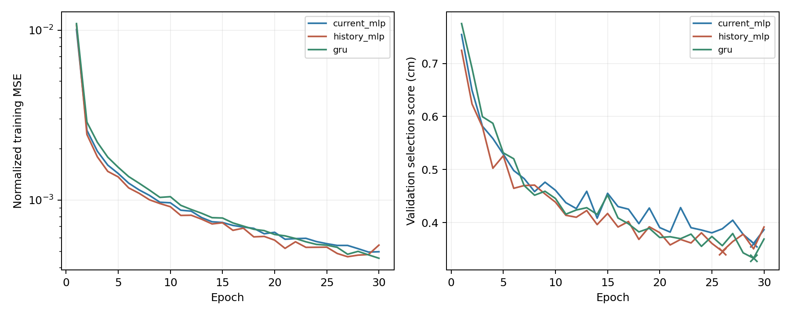

# MLP and GRU validation pilots

All three non-graph models trained successfully on the fixed 80-episode D0 subset. They improve on position hold and constant velocity on the same 100 validation episodes. GRU has the lowest mean error in this run, though its advantage over the MLPs is small. These are development results from seed 0; no D0 test or D1 prediction evaluation was performed.

## Protocol and results

Each model ran 30 epochs and 4,110 optimizer updates over 34,990 training windows. Validation contains 14,838 / 14,438 / 13,938 windows at 1 / 5 / 10 steps. Models share action conditioning, position-delta targets, train-only normalization, and validation selection rules. The [protocol and commands](../../docs/learning_baselines.md) give architecture and optimizer details. One set of weights serves all three horizons.

Errors below are in cm: first average Euclidean position error within each episode, then average equally across episodes. Columns correspond to 0.05 / 0.25 / 0.5 seconds.

| Model | End effector | Square nut |
| --- | --- | --- |
| Position hold | 0.715 / 3.344 / 6.242 | 0.490 / 2.313 / 4.309 |
| Constant velocity | 0.247 / 1.973 / 5.138 | 0.207 / 1.449 / 3.494 |
| Current-state MLP | 0.201 / 0.428 / 0.550 | 0.173 / 0.358 / 0.455 |
| History MLP | 0.183 / 0.387 / 0.518 | 0.179 / 0.365 / 0.446 |
| GRU | 0.176 / 0.367 / 0.496 | 0.179 / 0.342 / 0.437 |

The [comparison CSV](summary/comparison.csv) includes 95% episode-bootstrap intervals (2,000 resamples, seed 224). These describe variation across validation episodes, not training seeds. Checkpoint selection and reporting use the same validation set, so the results carry development-selection bias.

| Model | Parameters | Selected epoch | Train mean cm | Validation mean cm |
| --- | ---: | ---: | ---: | ---: |
| Current-state MLP | 109,318 | 29 | 0.27 | 0.361 |
| History MLP | 116,710 | 26 | 0.27 | 0.346 |
| GRU | 120,390 | 29 | 0.26 | 0.333 |

The mean here weights the six entity/horizon errors equally. Training errors are evaluated at the selected checkpoint. Validation curves fluctuate but improve overall; the train–validation gap does not suggest a failed fit. No additional hyperparameter search was run after these results.

The learned models use the complete planned action sequence through the requested horizon; hold and constant velocity ignore actions. The large long-horizon improvement therefore does not isolate the value of learned dynamics from the value of action conditioning. History helps end-effector prediction in this pilot, but current-state MLP has the lowest one-step nut error. We retain all three baselines rather than treating GRU as an established winner. Graph structure, equivariance, contact-specific gains, and closed-loop performance have not been tested here.

## Fitting and recovery checks

Before the pilot, each model fitted two training trajectories for 200 epochs. Normalized MSE fell from 0.0828 / 0.0922 / 0.0856 to 0.0000436 / 0.0000586 / 0.0000853 for current MLP / history MLP / GRU. The corresponding mean training errors were 0.093 / 0.105 / 0.112 cm. These checks establish that gradients and capacity are sufficient to fit a small sample; they are not generalization results.

For every architecture, six uninterrupted epochs matched three epochs followed by checkpoint recovery and three further epochs exactly: final model weights, optimizer state, sampler state, selected predictions, and selected metrics. See [continuation checks](resume_checks/checks.json). Separate evaluation processes also reproduced each pilot's prediction hash and summary exactly. Each training run's internal checkpoint reload had zero prediction difference. Agreement is specific to the tested hardware and software.

The Linux suite passed **29 tests**, including future-action isolation and model-gradient checks; lint and formatting passed. Recorded outputs: [tests](tests.txt), [lint](ruff.txt), [format](format.txt). Windows base checks passed 26 tests with three torch-dependent tests skipped; the full CUDA path was checked on AutoDL.

## Measured cost

Runs used the existing RTX 4090 D, float32, four CPU threads, deterministic algorithms, and PyTorch 2.5.1+cu121. The numeric cache was read from local AutoDL storage.

| Model | Input preparation s | Run s | Amortized ms/update | Sampled RSS MiB | Peak CUDA allocation MiB |
| --- | ---: | ---: | ---: | ---: | ---: |
| Current-state MLP | 8.36 | 38.57 | 9.03 | 1,057 | 166.85 |
| History MLP | 7.53 | 35.06 | 8.18 | 1,053 | 167.97 |
| GRU | 9.62 | 84.89 | 20.26 | 1,072 | 180.45 |

Run time includes training, validation, checkpoint writes, and final diagnostics; input preparation is reported separately. Amortized time divides summed epoch times by 4,110 updates and includes per-epoch validation, but excludes checkpoint writes. It is not an isolated GPU kernel measurement. RSS is sampled, not a continuous peak trace. CUDA allocation excludes the driver context and reserved allocator memory; it is not total device usage.

The three pilots consumed about 159 seconds of measured run time, plus 26 seconds of input preparation. A rough tenfold scaling to 800 episodes at the same 30 epochs suggests 6–7 minutes per MLP and about 14 minutes for GRU per seed. This deliberately scales even the fixed validation overhead and is only a planning estimate: episode lengths, preparation, device-resident arrays, and larger batches can change scaling. Three seeds of these three full-data baselines would be roughly 80 minutes of run time under that assumption. This does not estimate the later GNN/JEPA matrix; those models need their own measurements before formal runs.

## Artifacts and provenance

- [Summary](summary/summary.json): selected epochs, parameter counts, resource measurements, source commits, and checkpoint hashes.
- Pilot metrics and epoch logs: [current MLP](pilot_current_mlp/metrics.json), [history MLP](pilot_history_mlp/metrics.json), [GRU](pilot_gru/metrics.json). Each directory also contains episode errors and its training-only normalizer.
- Standalone reloads: [current MLP](pilot_current_mlp_reload.json), [history MLP](pilot_history_mlp_reload.json), [GRU](pilot_gru_reload.json).
- Two-episode fitting logs: [current MLP](fit_current_mlp/metrics.json), [history MLP](fit_history_mlp/metrics.json), [GRU](fit_gru/metrics.json).

Training and standalone evaluation used clean commit `32d8f519db051051d8421df9fb39cd06f8c0aef1`. Continuation checks and summary generation used clean commit `274d92ecce9111903baa2d3d546efd3c17e38fd5`, which added orchestration and plotting without changing the training implementation. Metrics record input, configuration, normalization, and relevant source hashes.

Checkpoints and full execution logs remain under `outputs/stage4` in the AutoDL checkout, including `pilot_<model>/best.pt` and `last.pt`. They are not public downloads. Reproduce them with the committed commands and the stage 3 cache; exported checkpoint hashes allow verification of the recorded files. Raw data and model binaries are excluded from Git.

Stage 4 is complete. The next stage is scene graphs and temporal GNNs with matched inputs, budgets, and graph-specific checks; it has not started.
