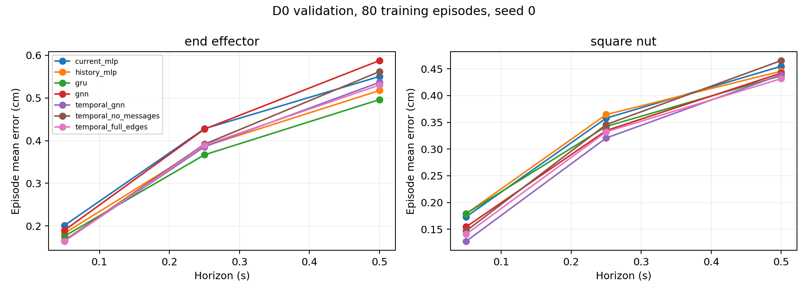
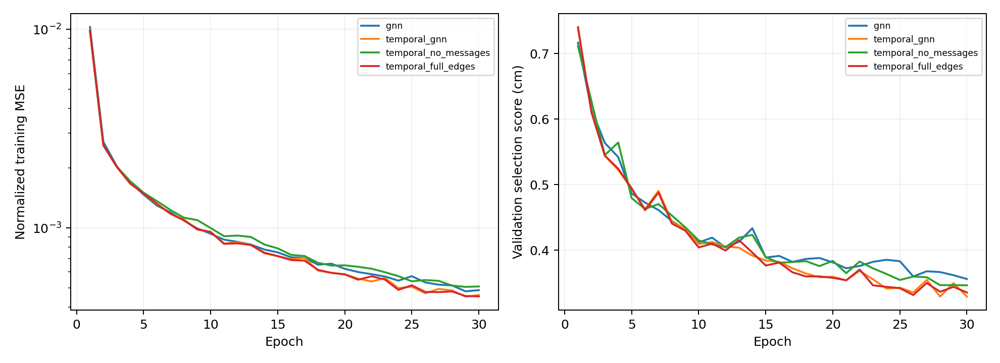
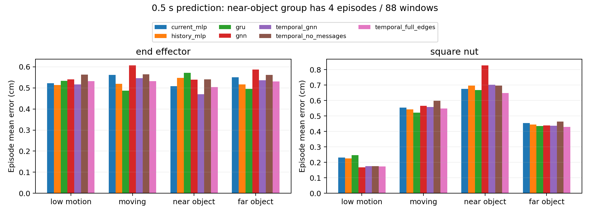

# Scene graph validation pilots

Stage 5 tests whether explicit scene graphs improve the non-graph baselines. The single-frame GNN is close to current-state MLP overall. Temporal GNN is close to GRU, with better one-step predictions but worse 0.5-second end-effector predictions. The results do not establish a general advantage for graph structure.

All runs use the same 80 D0 training episodes, 100 validation episodes, seed 0, three horizons, normalization rule, and 30-epoch budget as stage 4. Each model performs 4,110 optimizer updates over 34,990 training windows. Validation uses 14,838 / 14,438 / 13,938 windows at 1 / 5 / 10 steps. No D0 test or D1 prediction evaluation is used.

## Representation and controls

The graph contains end effector, square nut, peg, and table nodes. It retains positions, rotations, fixture geometry, gripper and robot joints, explicit relative vectors, and planned actions from the existing baselines. The [graph protocol](../../docs/graph_baselines.md) specifies feature slots, edge direction, PyG batching, model widths, and reproduction commands.

Single-frame GNN uses the latest state. Temporal GNN encodes each of four frames spatially and applies a per-node GRU. Two shared message-passing rounds use ten directed edges, omitting the static peg–table pair. Two temporal controls were specified before pilot results: closing learned messages, and adding both peg–table edges. Architecture and optimizer settings were not tuned after inspecting validation errors.

The temporal controls have the same nominal parameter count and update budget. Closing messages keeps their computation but gives the message network zero gradient; the effective capacity is therefore smaller. Explicit relative-position features remain available, so this is a learned-message ablation, not removal of all relational information. Equal update counts do not imply equal compute cost across architectures.

## Validation results

Errors are in cm. The three values in each entity column correspond to 0.05 / 0.25 / 0.5 seconds.

| Model | End effector | Square nut | Mean of six errors |
| --- | --- | --- | ---: |
| Current-state MLP | 0.201 / 0.428 / 0.550 | 0.173 / 0.358 / 0.455 | 0.361 |
| History MLP | 0.183 / 0.387 / 0.518 | 0.179 / 0.365 / 0.446 | 0.346 |
| GRU | 0.176 / 0.367 / 0.496 | 0.179 / 0.342 / 0.437 | 0.333 |
| Single-frame GNN | 0.190 / 0.427 / 0.588 | 0.154 / 0.335 / 0.442 | 0.356 |
| Temporal GNN | 0.165 / 0.386 / 0.537 | 0.128 / 0.321 / 0.439 | 0.329 |
| Temporal, messages closed | 0.166 / 0.392 / 0.562 | 0.147 / 0.346 / 0.465 | 0.346 |
| Temporal, full edges | 0.164 / 0.389 / 0.530 | 0.141 / 0.332 / 0.432 | 0.331 |

Temporal GNN improves the six-error mean by only 0.004 cm relative to GRU. Its observed run time is about 2.4 times GRU's, although the resource comparison is not isolated (see below). Adding the static fixture edges changes the mean by just +0.002 cm. Closing messages increases it by 0.017 cm. Thus learned messages help this graph model in this run, but neither graph connectivity choice clearly displaces GRU as a practical baseline.

| Model | Parameters | Selected epoch | Mean training error cm |
| --- | ---: | ---: | ---: |
| Single-frame GNN | 101,379 | 30 | 0.273 |
| Temporal GNN | 126,339 | 30 | 0.253 |
| Temporal, messages closed | 126,339 | 30 | 0.269 |
| Temporal, full edges | 126,339 | 26 | 0.257 |

The training errors use the selected checkpoint. All models fit the training sample reasonably; the learning curves show continued improvement with fluctuations rather than a failed optimization run. The default 30-epoch budget is retained, including runs whose best checkpoint is the final epoch. We did not extend training to seek a graph-model win.

## Where the differences occur

At 0.5 seconds, temporal GNN improves low-motion nut prediction but loses to GRU when the nut is moving. The paired episode-bootstrap difference (Temporal GNN minus GRU) is −0.072 cm, 95% interval [−0.084, −0.061], for low motion and +0.037 cm [0.021, 0.053] for moving windows. For the moving end effector it is +0.059 cm [0.046, 0.073]. These intervals are conditional on this seed and checkpoint selection.

| Entity / group | Episodes / windows | GRU | Temporal GNN | Messages closed | Full edges |
| --- | ---: | ---: | ---: | ---: | ---: |
| End effector, low motion | 100 / 3,253 | 0.534 | 0.516 | 0.564 | 0.532 |
| End effector, moving | 100 / 10,685 | 0.487 | 0.546 | 0.565 | 0.533 |
| Nut, low motion | 100 / 4,472 | 0.247 | 0.175 | 0.176 | 0.174 |
| Nut, moving | 100 / 9,466 | 0.522 | 0.558 | 0.598 | 0.548 |
| End effector, near object | 4 / 88 | 0.571 | 0.470 | 0.541 | 0.504 |
| Nut, near object | 4 / 88 | 0.667 | 0.702 | 0.696 | 0.649 |
| End effector, far object | 100 / 13,850 | 0.496 | 0.537 | 0.561 | 0.530 |
| Nut, far object | 100 / 13,850 | 0.436 | 0.437 | 0.464 | 0.430 |

The low-motion nut advantage largely survives without messages: 0.176 versus 0.175 cm. It cannot be credited solely to learned neighbor exchange. Messages do help moving-nut prediction relative to their removal, by 0.039 cm [0.027, 0.051], but this still falls short of GRU.

The predeclared 5 cm proximity threshold selects only **88 windows from four episodes** at 0.5 seconds. This is too sparse and limited a proxy to support a contact-stage claim. We keep the original threshold and report its poor coverage rather than choosing a more favorable threshold after seeing errors. Any future interaction-phase conclusion needs a better grounded definition fixed before final testing.

## Checks and measured cost

All four graph variants passed the two-episode, 200-epoch fitting check. Normalized training MSE fell from about 0.075–0.081 to 0.000041–0.000071; mean training errors were 0.077–0.094 cm. No training runs failed. Physical-field packing, edge direction, batch membership, node permutation, history use, and finite gradients were checked. The representation retains orientation, gripper, and joint information, so the mixed pilot result is not explained by those fields being omitted. These checks do not rule out every possible architectural or optimization limitation.

On eight real validation samples spread across the evaluation order, all four trained graph models preserved outputs under node permutation exactly. Individual versus batched predictions differed by at most 3.58e-7 in normalized delta units (checked at `atol=1e-6`, `rtol=1e-5`). Swapping measured nut orientations across samples changed end-effector output for each message-enabled model; closing messages reduced that pathway's effect to exactly zero. This verifies functioning neighbor exchange, not physical correctness of the response or geometric equivariance.

Both main architectures passed six-epoch uninterrupted versus 3+3-epoch resumed training checks: final weights, optimizer state, sampler state, selected predictions, and metrics matched exactly. Both controls passed internal and standalone checkpoint reloads; they were not given additional continuation runs. All seven learned models reproduced their full saved validation prediction hashes before group analysis. See [checks and detailed results](analysis/analysis.json) and [continuation checks](resume_checks/checks.json).

The Linux suite passed **36 tests**; lint, formatting, and dependency consistency checks passed. Windows passed 26 base tests, with four skip entries for unavailable torch/PyG coverage. CUDA training, reloads, and continuation checks ran on AutoDL.

| Model | Input preparation s | Run s | Amortized ms/update | Sampled RSS MiB | Peak CUDA allocation MiB |
| --- | ---: | ---: | ---: | ---: | ---: |
| Single-frame GNN | 6.85 | 125.85 | 30.12 | 1,355 | 236.29 |
| Temporal GNN | 9.30 | 205.37 | 44.76 | 1,367 | 434.16 |
| Temporal, messages closed | 9.22 | 220.55 | 48.59 | 1,396 | 434.16 |
| Temporal, full edges | 9.06 | 206.66 | 48.51 | 1,369 | 476.23 |

The four pilots total 758 seconds (12.6 minutes) of measured run time plus 34 seconds of input preparation on the RTX 4090 D. Run time includes training, validation, checkpoint writes, and final diagnostics; it excludes preprocessing, initial model evaluation/device setup, standalone evaluation, and continuation checks. Amortized update time includes per-epoch validation but excludes checkpoint writes. RSS is sampled; PyTorch allocation excludes driver context and reserved memory. Small timing differences between temporal controls should not be interpreted as algorithmic speedups on this shared host.

The GPU was idle at the initial check. At the final check, another workload occupied about 18 GiB; its process start time overlaps the temporal pilots. We left that workload untouched. The recorded wall times may therefore include contention and are not an isolated architecture-speed benchmark.

## Artifacts and reproduction

- [Overall errors and intervals](analysis/overall.csv), [group episode errors](analysis/group_episodes.csv), and [full analysis including paired differences](analysis/analysis.json).
- Pilot logs, selected epochs, data/source hashes, normalizers, and checkpoint hashes: [single-frame](pilot_gnn/metrics.json), [temporal](pilot_temporal_gnn/metrics.json), [messages closed](pilot_temporal_no_messages/metrics.json), [full edges](pilot_temporal_full_edges/metrics.json). Each directory also has episode errors and its normalizer.
- Fitting results: [single-frame](fit_gnn/metrics.json), [temporal](fit_temporal_gnn/metrics.json), [messages closed](fit_temporal_no_messages/metrics.json), [full edges](fit_temporal_full_edges/metrics.json).
- [Tests](tests.txt), [lint](ruff.txt), [format](format.txt), [dependency check](dependencies.txt), [final verification and analysis checksum](verification.json), and the [installed environment](../../requirements/linux-stage5.lock.txt).

Fitting checks used clean commit `65b44757359743f57451ede9c2aeeb763426decc`. Pilots, independent reloads, continuation checks, and numerical analysis used clean commit `63f28343c48f5976cc2c2e42935c8a50f70ff8fa`. The MLP/GRU metrics remain the stage 4 runs; they were reloaded, not retrained. Figure rendering was subsequently separated into `robot_dynamics.plot_graphs` and the proximity sample count added to the chart; the recorded numerical analysis was unchanged.

Checkpoints remain under `outputs/stage5/pilot_<model>/{best,last}.pt` on AutoDL. They are not public downloads. The [protocol](../../docs/graph_baselines.md) provides training, resume, evaluation, analysis, and CPU-only figure reproduction commands. For a fresh rerun, choose new output paths to retain previous records.

Stage 5 is complete. Stage 6 will address geometric equivariance; no stage 6 jobs have started.

## Scope

Errors are averaged within each episode and then equally across episodes. Confidence intervals use 2,000 episode-bootstrap resamples with seed 224; they do not include training-seed variability. Checkpoints are selected and reported on the same validation set, so these remain development results. A difference in one seed or one group is a hypothesis for the formal matrix, not a generalization claim.

Motion groups use the stage 3 past-speed thresholds fitted on D0 training episodes. A separate proximity split uses current end-effector-to-nut distance at most 5 cm versus farther away. These rules were fixed before examining graph errors. Proximity is not measured contact, and the two grouping schemes overlap; their rows should not be combined as disjoint task phases.

No geometric equivariance, JEPA pretraining, final-test performance, or closed-loop success is claimed in this stage.
