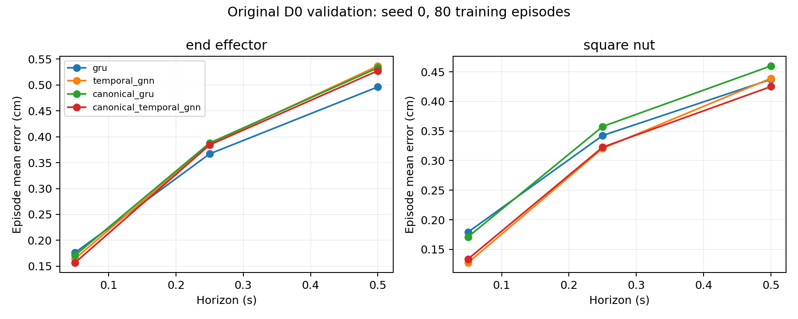
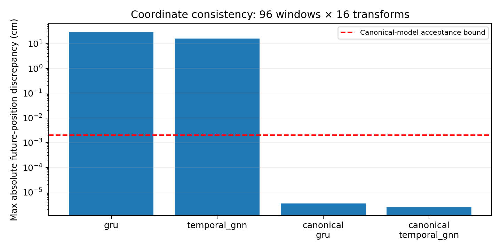

# Coordinate-equivariant prediction

Both canonical-frame models passed the full prediction-chain equivariance checks. This establishes coordinate consistency for the declared yaw/translation group. Prediction accuracy is a separate result: canonical Temporal GNN slightly improves the D0 validation mean, while canonical GRU performs worse than ordinary GRU. Neither result establishes improved physical OOD generalization.

## What was implemented

The observed peg position and orientation define a common coordinate frame for every history step. Positions, orientations, relative vectors, normals, and pose actions are expressed in that frame; the existing backbone predicts local deltas, which are rotated back before reconstructing future positions. This is a **known-frame canonicalization construction**, not an EGNN message layer. The wrapper adds no learned parameters. A GRU with the identical coordinate treatment provides a non-graph control.

The declared transformations are proper yaw rotations and translations of the entire coordinate system, preserving the gravity direction. They are not independent physical movements of the nut, peg, or robot. Reflections, pitch/roll, changed gravity, and controller replay under newly rotated commands are not claimed. Rotated action components are not clipped during passive-coordinate checks. The [protocol](../../docs/equivariance_protocol.md) gives the transformation rules, proof, normalization argument, limits, and commands.

## Prediction accuracy

All pilots use seed 0, 80 D0 training episodes, 100 D0 validation episodes, four history frames, and the same 30 epochs / 4,110 updates. Each model shares weights across 1, 5, and 10 steps. There are 34,990 training windows and 14,838 / 14,438 / 13,938 validation windows at the three horizons. No augmentation, extra features, or post-result parameter search was added.

Errors are in cm, averaged within each episode and then equally across episodes. Entity columns list 0.05 / 0.25 / 0.5 seconds.

| Model | End effector | Square nut | Mean of six errors |
| --- | --- | --- | ---: |
| GRU | 0.176 / 0.367 / 0.496 | 0.179 / 0.342 / 0.437 | 0.333 |
| Temporal GNN | 0.165 / 0.386 / 0.537 | 0.128 / 0.321 / 0.439 | 0.329 |
| Canonical GRU | 0.171 / 0.388 / 0.533 | 0.171 / 0.358 / 0.460 | 0.347 |
| Canonical Temporal GNN | 0.157 / 0.384 / 0.527 | 0.134 / 0.323 / 0.425 | 0.325 |



Canonicalization improves the Temporal GNN mean by about **1.2%** (0.0041 cm) and worsens the GRU mean by about **4.1%** (0.0137 cm). Canonical Temporal GNN has the lowest overall mean here, but ordinary GRU still has lower 0.25- and 0.5-second end-effector error. The evidence does not support a universal benefit from either graph structure or coordinate canonicalization.

| Model | Parameters | Selected epoch | Mean training error cm |
| --- | ---: | ---: | ---: |
| GRU | 120,390 | 29 | 0.261 |
| Temporal GNN | 126,339 | 30 | 0.253 |
| Canonical GRU | 120,390 | 28 | 0.274 |
| Canonical Temporal GNN | 126,339 | 30 | 0.245 |

These are single-seed development results. Checkpoint selection and reporting use the same validation set. The [analysis JSON](analysis/analysis.json) includes 95% episode-bootstrap intervals (2,000 resamples, seed 224); they do not measure training-seed variability. We retained the fixed budget rather than extending runs whose best checkpoint was the final epoch.

## Coordinate consistency

The check begins with raw physical windows, transforms all relevant fields, applies the **unchanged training-only normalizer**, runs the full temporal model, and reconstructs future positions in metres. It compares these predictions with the appropriately transformed original predictions. The diagnostic uses 96 validation episodes/windows, 32 per horizon, and 16 fixed-seed transformations (1,536 window-transform pairs per model). Transformations include pure translation, pure yaw, and combined changes with translations up to 0.5 m per axis.

| Model | Maximum absolute future-position discrepancy, m |
| --- | ---: |
| GRU | 0.2942 |
| Temporal GNN | 0.1633 |
| Canonical GRU | 3.47e-8 |
| Canonical Temporal GNN | 2.54e-8 |

Both canonical models pass the predeclared **2e-5 m** tolerance. Ordinary models were diagnostic controls and were not required to pass it. The discrepancy above is a coordinate-consistency residual, **not prediction error against a new physical rollout**. Large residuals for the ordinary models must not be presented as D1 performance. The GRU control also passes after canonicalization, showing that this property is not unique to a graph backbone.



Random-weight tests also passed with a nonzero normalization center and isotropic scale. Transformation/inverse tests cover positions, rotations, actions, target deltas, causal velocities, and gravity; unsupported reflections are rejected. The implementation has no frame-search or sign-selection ambiguity because it uses the labeled peg's measured pose. Its symmetry constraint can remove absolute pose information relevant to an unmodeled robot base, so mathematical equivariance alone does not guarantee better task prediction.

## Real placement coverage

A separate diagnostic groups actual D0 validation episodes by their initial nut XY position in the peg frame. The boundary is the convex hull of the 80 training placements, fitted without validation errors or an error-selected threshold. It contains 95 validation placements; five lie outside. These are real trajectories, but all still come from D0's data-generating distribution.

At 0.5 seconds, the inside group has 13,235 windows and the outside group 703 windows. Each cell lists end-effector / nut error in cm.

| Model | Inside training hull: 95 episodes | Outside training hull: 5 episodes |
| --- | --- | --- |
| GRU | 0.497 / 0.438 | 0.482 / 0.412 |
| Temporal GNN | 0.537 / 0.441 | 0.535 / 0.396 |
| Canonical GRU | 0.531 / 0.461 | 0.573 / 0.444 |
| Canonical Temporal GNN | 0.527 / 0.426 | 0.531 / 0.408 |

There is no consistent outside-hull advantage for canonicalization. The group has only five episodes and is not matched for trajectory difficulty, so it cannot support a strong extrapolation claim. Counts, memberships, training positions, all horizons, and intervals are in [physical_support.json](analysis/physical_support.json).

**Physical distribution-shift performance remains unmeasured:** D1 and held-out D0 have not been used for prediction evaluation. They remain reserved for the frozen formal protocol in stage 8. Neither coordinate-transformed windows nor this finite-training-set coverage split replaces that evaluation.

## Reliability and resources

Both new models passed two-episode fitting checks before the pilot. Normalized MSE fell from 0.0753 to 0.0000447 for canonical Temporal GNN, and from 0.0831 to 0.0000818 for canonical GRU. Their selected mean training errors were 0.092 and 0.114 cm. No fit, pilot, continuation, or coordinate-check run failed.

For each new model, six uninterrupted epochs exactly matched a three-epoch run resumed for three more epochs: final weights, optimizer state, sampler state, selected predictions, and selected metrics. Internal and independent reload evaluations matched. Before comparing models, all four complete validation prediction hashes were reproduced, including the original stage 4/5 baselines; those baselines were not retrained. See [continuation checks](resume_checks/checks.json).

The Linux suite passed **39 tests**, with lint, formatting, and dependency checks passing. Windows passed 27 base tests with six skip entries for unavailable torch/PyG coverage. The [verification record](verification.json) identifies the final check commit and hashes both analysis files. Necessary data, source, finite-value, checkpoint, and transform-domain checks were retained during code review.

| New model | Input preparation s | Run s | Amortized ms/update | Sampled RSS MiB | Peak CUDA allocation MiB |
| --- | ---: | ---: | ---: | ---: | ---: |
| Canonical Temporal GNN | 9.34 | 237.50 | 52.31 | 1,384 | 437.77 |
| Canonical GRU | 8.95 | 122.89 | 29.46 | 1,086 | 184.95 |

The two pilots total about **360 seconds** of measured run time plus 18 seconds of input preparation on the RTX 4090 D. Run time includes training, validation, checkpoint writes, and final training-process diagnostics, but excludes initial evaluation/device setup, standalone reloads, continuation checks, and the coordinate analysis. Amortized update time includes per-epoch validation but excludes checkpoint writes. RSS is sampled; CUDA allocation excludes driver context and reserved memory.

Other GPU work was active at the initial resource check (about 18.5 GiB already used) and utilization changed during the runs. We did not alter other workloads. These are observed costs on a shared GPU, not controlled speed comparisons against the earlier pilots.

## Files and reproduction

- [Full comparison and coordinate checks](analysis/analysis.json), [physical-placement diagnostic](analysis/physical_support.json), and the PNG/PDF figures alongside them.
- Pilot metrics and epoch logs: [canonical Temporal GNN](pilot_canonical_temporal_gnn/metrics.json), [canonical GRU](pilot_canonical_gru/metrics.json). Each directory also contains its normalizer and episode-level errors.
- Independent reloads: [canonical Temporal GNN](pilot_canonical_temporal_gnn_reload.json), [canonical GRU](pilot_canonical_gru_reload.json).
- Fit logs: [canonical Temporal GNN](fit_canonical_temporal_gnn/metrics.json), [canonical GRU](fit_canonical_gru/metrics.json).
- [Tests](tests.txt), [lint](ruff.txt), [format](format.txt), [dependencies](dependencies.txt), and [verification](verification.json).

Fitting used clean commit `1dd4ef3`; pilots, reloads, continuation, and coordinate analysis used clean commit `246f4d0`. Placement analysis and final checks used clean commit `996f97e`. Full commit IDs and input/source/checkpoint hashes are recorded in the artifacts. The existing stage 5 environment lock still applies; no packages were added.

Checkpoints remain on AutoDL at `outputs/stage6/pilot_<model>/{best,last}.pt`; they are not public downloads. The [protocol](../../docs/equivariance_protocol.md) contains tested training, resume, and evaluation commands. To redraw the figures from the committed result file without data or a GPU:

```bash
python -m robot_dynamics.plot_equivariance reports/stage6/analysis/analysis.json --output outputs/stage6_figures
```

Stage 6 is complete with full-chain coordinate checks and matched D0 pilots. D1 claims remain pending formal evaluation. Stage 7 will add JEPA and pretraining controls; no stage 7 jobs have started.
