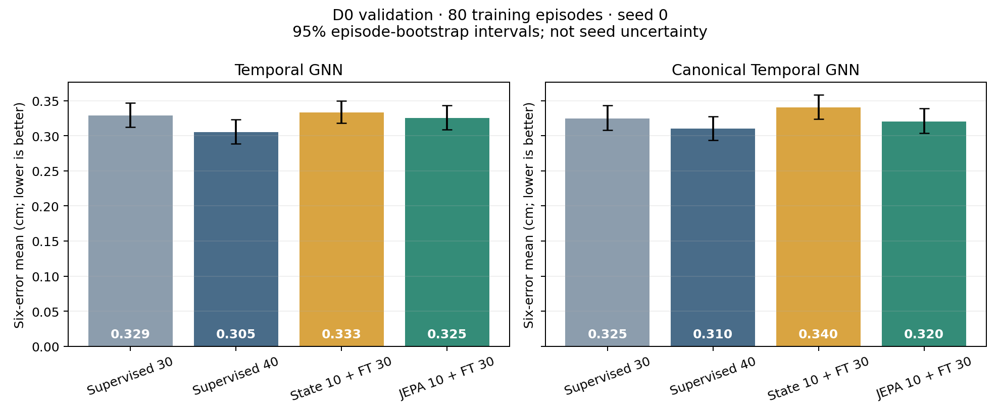
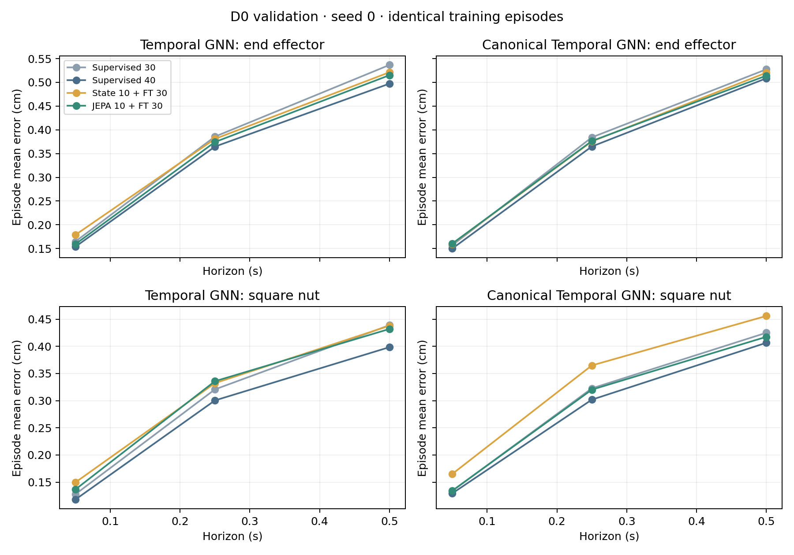

# Predictive pretraining

This pilot tests whether JEPA helps the ordinary or canonical-frame Temporal GNN beyond extra supervised training. It uses the same 80 D0 training episodes and 100 validation episodes as stages 4–6, seed 0, four-frame histories, and 1/5/10-step horizons. D0 test and D1 remain reserved for stage 8. The score averages the six entity/horizon errors, with equal weight per episode; units are cm.

**At this budget, JEPA does not beat longer direct supervision.** It improves on direct-state pretraining in both architectures, but 40 supervised epochs produce the lowest errors. The small improvements over the older 30-epoch models therefore do not establish a JEPA-specific benefit. No extra configurations were searched after seeing these results.

## Prediction results

“10 + 30” means ten pretraining epochs followed by thirty full fine-tuning epochs. The best-epoch column counts both phases. Every new run finished all forty epochs; the reported checkpoint was selected from epochs 11–40.

| Architecture | Training | Six-error mean | Eef at 0.5 s | Nut at 0.5 s | Best epoch |
| --- | --- | ---: | ---: | ---: | ---: |
| Ordinary | Supervised 30, earlier reference | 0.3290 | 0.5366 | 0.4389 | 30 |
| Ordinary | Supervised 40 | **0.3054** | 0.4973 | 0.3985 | 39 |
| Ordinary | State 10 + 30 | 0.3334 | 0.5213 | 0.4379 | 39 |
| Ordinary | JEPA 10 + 30 | 0.3254 | 0.5151 | 0.4320 | 40 |
| Canonical | Supervised 30, earlier reference | 0.3249 | 0.5274 | 0.4250 | 30 |
| Canonical | Supervised 40 | **0.3102** | 0.5086 | 0.4066 | 39 |
| Canonical | State 10 + 30 | 0.3403 | 0.5204 | 0.4560 | 40 |
| Canonical | JEPA 10 + 30 | 0.3205 | 0.5141 | 0.4175 | 38 |



Paired differences use the same 100 validation episodes and 2,000 bootstrap resamples, with bootstrap seed 224. Negative differences favor JEPA. These paired intervals are more informative than overlap between the marginal intervals in the bar chart.

| Architecture | JEPA minus control | Difference, cm | 95% episode-bootstrap interval |
| --- | --- | ---: | --- |
| Ordinary | State 10 + 30 | −0.0080 | [−0.0118, −0.0041] |
| Ordinary | Supervised 40 | +0.0200 | [+0.0166, +0.0236] |
| Canonical | State 10 + 30 | −0.0198 | [−0.0234, −0.0159] |
| Canonical | Supervised 40 | +0.0103 | [+0.0065, +0.0144] |

Compared with supervised 40, JEPA's mean error is about 6.6% higher for the ordinary model and 3.3% higher for the canonical model. The canonical-minus-ordinary difference in JEPA's effect is −0.0097 cm, with interval [−0.0143, −0.0054]. This means the JEPA penalty is smaller with canonicalization; it does **not** turn either comparison into a JEPA benefit. The ordinary 40-epoch supervised model also slightly outperforms its canonical counterpart. Neither factor is uniformly beneficial.



The 40-epoch supervised control beats JEPA on all six entity/horizon means in each architecture. Full values and intervals are in [summary.csv](analysis/summary.csv) and [analysis.json](analysis/analysis.json). Most selected checkpoints occur near the end of the budget, so these experiments compare fixed budgets rather than fully converged or optimally tuned methods.

## What is compared

For each architecture, JEPA and direct future-state pretraining use 10 pretraining epochs followed by 30 epochs of full fine-tuning. The physical prediction head returns to its initial seeded weights at that boundary, and AdamW starts afresh. A direct-supervision control trains continuously for 40 epochs. All new runs make 5,480 updates over the same context-window order, with the last 30 epochs eligible for validation-based checkpoint selection. Earlier 30-epoch supervised runs are lower-budget references, not the main fairness controls.

Each epoch contains 34,990 training windows. Every new run therefore presents 1,399,600 context windows, counting repeats. JEPA and state pretraining additionally process 349,900 future-history targets from those same episodes. They do not use an extra unlabeled dataset. Direct-state targets contain 132 physical values from the four future-history frames; JEPA predicts 64-dimensional latents for each dynamic node. Both discard their auxiliary modules at inference. All physical predictors have 126,339 parameters. JEPA adds 78,784 auxiliary parameters during pretraining, including a frozen 62,208-parameter EMA encoder; the state head adds 19,156 trainable parameters.

The target history ends at `t+k`; it overlaps the context at short horizons. Target actions and horizon codes are zero. Future observations enter only the training target branch, never the downstream inference input. The JEPA objective includes fixed variance and covariance penalties, so this is a **regularized, numerical-state JEPA adaptation**, not a reproduction of image I-JEPA. Full details and commands are in the [protocol](../../docs/pretraining_protocol.md).

## Representation and input checks

Both JEPA variants pass the predeclared gross-collapse screen on 1,024 fixed training windows at the end of pretraining. Each dynamic node must have mean across-sample standard deviation at least 0.01 and covariance effective rank at least 2. The checks cover raw online and target latents, plus layer-normalized target and predictor outputs. Values below list end effector / nut separately.

| JEPA model | Online raw std | Target raw std | Normalized target rank | Normalized prediction rank | Normalized prediction MSE |
| --- | --- | --- | --- | --- | ---: |
| Ordinary | 0.212 / 0.212 | 0.191 / 0.181 | 15.15 / 12.48 | 14.16 / 11.95 | 0.01170 |
| Canonical | 0.213 / 0.211 | 0.185 / 0.175 | 15.15 / 12.12 | 14.16 / 11.40 | 0.01197 |

Target/online parameter RMS distances are 0.00536 and 0.00529. Unit tests verify that the online encoder receives gradients, the target and physical head receive none during JEPA pretraining, and EMA updates use the declared formula. They also verify the physical target layout and causal separation between online context and future observations. The physical head is reset before full fine-tuning. Thus the negative result is not explained by the collapse, gradient, target-update, or reload failures checked here; these checks do not prove that the learned representation is optimal.

On a fixed 1,024-window validation subset, zeroing planned actions changes JEPA predictions by 2.625 cm (ordinary) and 2.562 cm (canonical), measured as mean position-output displacement. Permuting past histories while retaining the current state changes them by 1.431 and 1.688 cm. Sample mean errors rise from 0.329 / 0.322 cm to 2.624 / 2.599 cm with zero actions, and to 1.498 / 1.734 cm with permuted pasts. These sample-weighted diagnostic errors differ from the main episode-weighted score. All six models' sensitivity results are retained in the analysis file. The pretrained latent predictor also responds to zeroed actions, with normalized-output RMS changes of 0.226 / 0.214.

Full-chain coordinate checks use the same 96 raw windows and 16 yaw/translation transformations as stage 6, including fixed training normalization and physical output decoding. Maximum absolute discrepancies are 3.01e-8 m for supervised 40, 2.71e-8 m for state pretraining, and 3.99e-8 m for JEPA, all below the 2e-5 m tolerance. Pretraining has preserved the declared coordinate property.

## Resources

Times below are seconds. “Initial updates” covers the first ten epochs, which are supervised training for the direct control; “later updates” covers the remaining thirty. Run time includes training, validation, checkpoint writes, and final training-process diagnostics, but excludes input preparation, independent evaluation, resume checks, and the separate analysis. Memory columns are sampled process RSS and peak allocated CUDA memory, in MiB; CUDA allocation excludes driver context and reserved memory.

| Architecture / method | Input preparation | Initial updates | Later updates | Validation | Run | RSS / CUDA MiB |
| --- | ---: | ---: | ---: | ---: | ---: | --- |
| Ordinary / supervised | 9.49 | 53.62 | 156.77 | 17.82 | 231.83 | 1,404 / 432 |
| Ordinary / state | 12.59 | 52.11 | 157.93 | 18.15 | 231.86 | 1,456 / 471 |
| Ordinary / JEPA | 12.53 | 64.97 | 155.66 | 17.90 | 242.48 | 1,487 / 472 |
| Canonical / supervised | 9.04 | 62.58 | 184.25 | 19.07 | 269.59 | 1,389 / 436 |
| Canonical / state | 11.43 | 64.45 | 188.47 | 19.11 | 275.73 | 1,424 / 475 |
| Canonical / JEPA | 10.16 | 71.05 | 185.44 | 18.94 | 279.29 | 1,495 / 476 |

The six pilots total **25.5 minutes** of measured run time plus **65.2 seconds** of input preparation on the existing RTX 4090 D. JEPA used about 4.9% more update time than supervised 40 in the ordinary architecture and 3.9% more in the canonical architecture. It did not receive less measured computation than the stronger direct-supervision control. These comparisons are approximately matched in measured update time, exactly matched in updates/context presentations, and not claimed to be FLOP-matched.

## Reliability

All six small two-trajectory checks completed pretraining, the phase transition, and fine-tuning. Each uninterrupted run exactly matched a run stopped after epoch 2, resumed through epoch 4, then resumed to epoch 6. Comparisons cover model and auxiliary weights, optimizer, sampler, CPU/CUDA RNG, initial head, selected prediction hash, and selected summary. See [resume checks](resume_checks/checks.json) and the continuous/resumed metrics alongside them.

All six pilots finished and independently reloaded successfully. The comparison reproduced all eight full validation prediction hashes, including both earlier supervised references; those references were not retrained. Checkpoint, historical source, data, split, and normalizer hashes were verified. Normalization remains fitted only to the 80 training episodes. No pilot or resume run failed.

The final Linux suite passed **43 tests**; lint, formatting, and dependency checks passed. Windows passed 27 base tests with seven skip entries for unavailable torch/PyG coverage. Both figures were inspected and regenerated on Windows from the saved analysis without data or checkpoints. Code review retained the causal, finite-value, provenance, overwrite, and coordinate-domain checks; no speculative fallback paths were added.

An initial unit-test run had two failures because it checked representation rank after deliberately perturbing every weight for an EMA arithmetic test. Moving the rank check before that perturbation fixed the test; training code was not changed for this issue. The [original failure log](tests_initial.txt) is retained alongside the [passing suite](tests.txt). This test-ordering mistake is separate from the full pilots' collapse diagnostics.

## Interpretation limits

Validation selects checkpoints and supplies these exploratory comparisons. Episode-bootstrap intervals describe variation among these 100 episodes, conditional on one trained model; they do not capture training-seed variance or remove model-selection optimism. Any apparent interaction between JEPA and canonicalization still needs repeated seeds.

The canonical model uses the observed peg frame and tests gravity-preserving yaw/translation coordinate changes. Coordinate consistency is not physical distribution-shift performance. Perturbing histories or zeroing planned actions is an input-sensitivity diagnostic, not a realistic rollout or a causal attribution experiment. Pretraining comparisons within graph architectures also do not establish a graph advantage over non-graph models.

Updates and context presentations are matched, while FLOPs are not assumed identical. JEPA performs an additional target-encoder pass. Phase-specific update times are reported separately from validation and checkpoint overhead. Timings come from an existing shared GPU and include brief diagnostic workloads; they are observed costs, not a controlled hardware benchmark.

## Files and reproduction

- [Analysis and diagnostics](analysis/analysis.json), [per-horizon summary](analysis/summary.csv), and PNG/PDF figures in the same directory.
- Ordinary-model metrics: [JEPA](temporal_gnn_jepa/metrics.json), [state](temporal_gnn_state/metrics.json), [supervised](temporal_gnn_supervised/metrics.json).
- Canonical-model metrics: [JEPA](canonical_temporal_gnn_jepa/metrics.json), [state](canonical_temporal_gnn_state/metrics.json), [supervised](canonical_temporal_gnn_supervised/metrics.json). Each run directory includes its normalizer and episode-level errors; independent reload JSON files are alongside the directories.
- [Verification](verification.json), [tests](tests.txt), [lint](ruff.txt), [formatting](format.txt), and [dependencies](dependencies.txt).

Resume checks used clean commit `39f55ec`. The six pilots and independent evaluations used clean commit `91bb458`; analysis, plotting, and final Linux checks used clean commit `b35f7c6`. Full source and checkpoint hashes are recorded in the JSON artifacts. No new packages were installed; the stage 5 Linux lock remains applicable.

Checkpoints remain on AutoDL at `outputs/stage7/<model>_<method>/{pretrained,best,last}.pt`. The [protocol](../../docs/pretraining_protocol.md) contains the tested training, recovery, evaluation, and analysis commands. Figures can be regenerated without raw data or a GPU:

```bash
python -m robot_dynamics.plot_pretraining reports/stage7/analysis/analysis.json --output outputs/stage7_figures
```

Stage 7 is complete with all four core combinations, both pretraining controls, and the declared reliability checks. Stage 8 has not started. It will freeze a limited formal protocol and test-use rules, then measure the required repeated-seed matrix and its controls; these pilots do not replace that evaluation.
