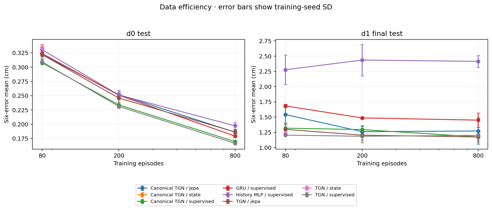
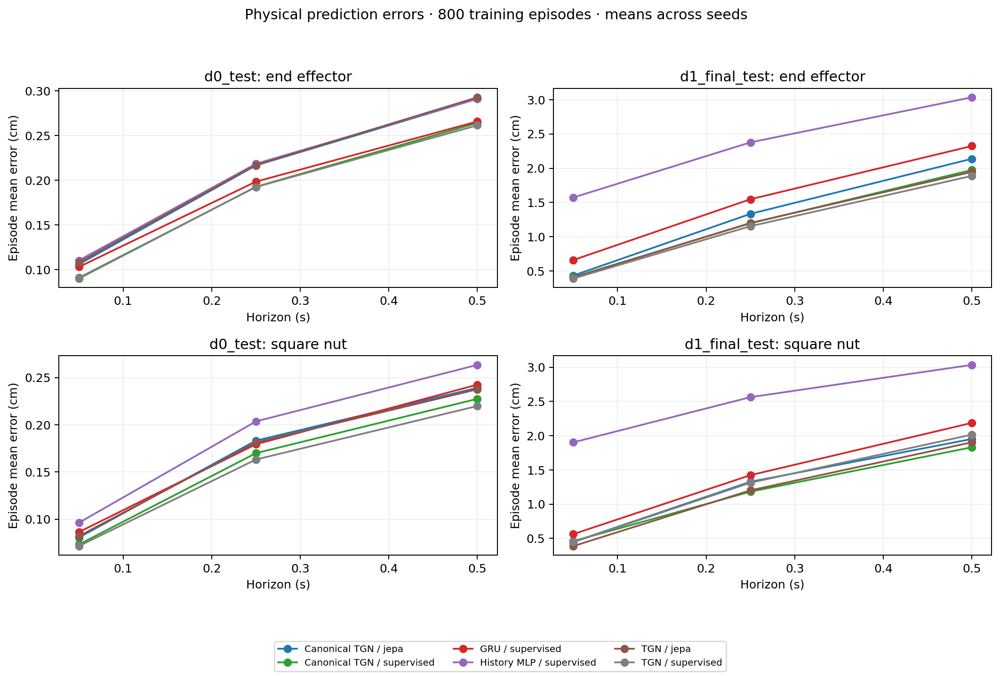
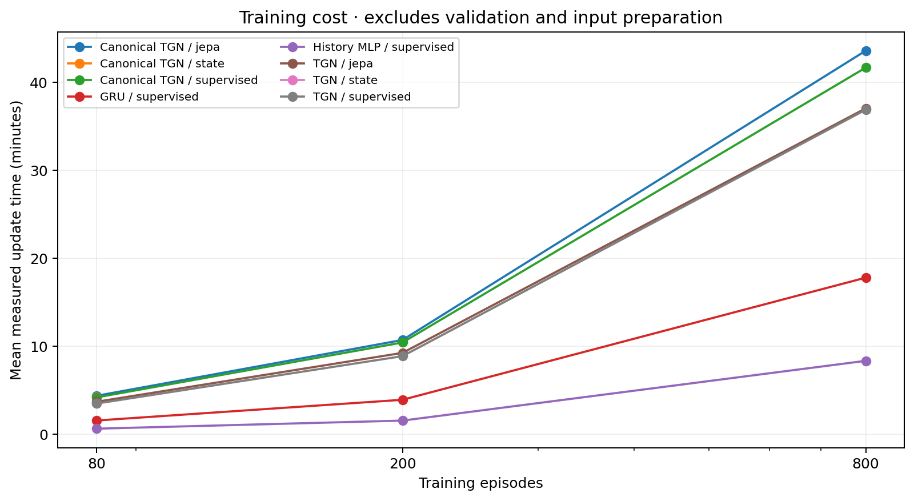

# Formal Square results

**Stage 8 is complete. Directly supervised Temporal GNN outperforms the tested MLP and GRU controls on both held-out D0 and D1. JEPA and canonicalization do not provide a consistent additional gain.** This is evidence for these graph-model configurations on this task, not a claim that graph methods always win or that the full Graph-JEPA combination is superior.

All 60 configurations finished: 36 core, 18 MLP/GRU controls, and six small-data state-pretraining controls. They comprise 84 training phases and 124 test prediction sets including hold/constant-velocity baselines. Seeds are 0, 1, and 2. Each model shares the 0.05/0.25/0.5-second horizons. The same 100 D0 validation episodes selected checkpoints before the 100 held-out D0 and 1,000 D1 episodes were evaluated.

The [frozen protocol](../../docs/formal_protocol.md), [matrix](formal/matrix.json), and [selection seal](formal/selection_seal.json) preserve the choices made before test access. Direct supervision uses 40 epochs; JEPA/state pretraining uses 10 + 30, with full fine-tuning. All have 30 checkpoint-selection opportunities and matched updates/context presentations within a data fraction. No test-driven tuning, seed replacement, or extra configuration search was performed.

## Main results

Each cell is the six-error mean ± sample SD across three training seeds, in **cm**. The score gives equal weight to episodes, entities, and horizons. SD is not an episode confidence interval. Every seed is retained in the linked JSON and CSV artifacts.

### Held-out D0

| Model | 80 training episodes | 200 training episodes | 800 training episodes |
| --- | ---: | ---: | ---: |
| History MLP | 0.3305 ± 0.0023 | 0.2512 ± 0.0082 | 0.1972 ± 0.0057 |
| GRU | 0.3239 ± 0.0041 | 0.2508 ± 0.0041 | 0.1792 ± 0.0015 |
| Temporal GNN | 0.3093 ± 0.0053 | 0.2312 ± 0.0034 | 0.1665 ± 0.0014 |
| Canonical Temporal GNN | 0.3077 ± 0.0010 | 0.2338 ± 0.0016 | 0.1696 ± 0.0007 |
| Temporal GNN + JEPA | 0.3219 ± 0.0036 | 0.2459 ± 0.0077 | 0.1865 ± 0.0031 |
| Canonical Temporal GNN + JEPA | 0.3219 ± 0.0083 | 0.2519 ± 0.0050 | 0.1861 ± 0.0044 |

### D1 distribution shift

| Model | 80 training episodes | 200 training episodes | 800 training episodes |
| --- | ---: | ---: | ---: |
| History MLP | 2.2764 ± 0.2436 | 2.4354 ± 0.2585 | 2.4142 ± 0.0968 |
| GRU | 1.6842 ± 0.0288 | 1.4861 ± 0.0199 | 1.4505 ± 0.1171 |
| Temporal GNN | 1.2043 ± 0.0126 | 1.1856 ± 0.1038 | 1.2009 ± 0.0227 |
| Canonical Temporal GNN | 1.3184 ± 0.0845 | 1.2955 ± 0.0651 | 1.1754 ± 0.0541 |
| Temporal GNN + JEPA | 1.2990 ± 0.0109 | 1.2039 ± 0.0807 | 1.1740 ± 0.0838 |
| Canonical Temporal GNN + JEPA | 1.5421 ± 0.1685 | 1.2616 ± 0.0873 | 1.2721 ± 0.2158 |



At 800 episodes, ordinary supervised Temporal GNN reduces error relative to GRU by **7.1% on D0** and **17.2% on D1**. Relative to history MLP, the reductions are 15.5% and 50.3%. Its mean is lower than each non-graph control at every tested fraction and split, and the direction holds in all 18 matched seed/fraction/split comparisons against each control.

More D0 data steadily improves D0 accuracy, but ordinary supervised TGN stays around 1.19–1.20 cm on D1 across the three fractions. Its D1 error at 800 episodes is about 7.2 times its D0 error. Thus a graph advantage coexists with a substantial unresolved distribution shift; increasing D0 data alone has not removed it.

### Paired evidence and uncertainty

The preregistered bootstrap jointly resamples seed labels and shared episode IDs (2,000 draws, seed 224). Negative differences favor the first method. These intervals are approximate with only three training seeds, are not adjusted for multiple comparisons, and should not be read as broad guarantees.

| Split | Training episodes | TGN − GRU, cm | 95% seed/episode-bootstrap interval |
| --- | ---: | ---: | --- |
| d0_test | 80 | -0.0146 | [-0.0248, -0.0060] |
| d0_test | 200 | -0.0196 | [-0.0273, -0.0123] |
| d0_test | 800 | -0.0127 | [-0.0143, -0.0111] |
| d1_final_test | 80 | -0.4799 | [-0.5060, -0.4498] |
| d1_final_test | 200 | -0.3004 | [-0.4299, -0.2209] |
| d1_final_test | 800 | -0.2495 | [-0.4047, -0.1572] |

For the full-data D1 comparison, the three TGN−GRU differences are −0.1762, −0.4106, and −0.1617 cm. The gain is not created by retaining one favorable seed. However, graph and non-graph architectures differ in more than message passing, and their compute costs are unequal. This matrix does not isolate a causal effect of edges alone or establish compute-normalized superiority.

## JEPA, canonicalization, and controls

JEPA worsens D0 mean error for both graph architectures at all three data fractions. At 800 episodes, its penalty is +0.0199 cm for ordinary TGN (interval [+0.0158, +0.0238]) and +0.0165 cm for canonical TGN ([+0.0116, +0.0206]). These results do not support a D0 pretraining benefit at the frozen budget.

On D1, some mean differences favor JEPA but change sign across seeds. At 800 episodes, ordinary JEPA improves the mean by 0.0270 cm, yet its interval is [−0.1362, +0.0434], with seed differences −0.1374, +0.0473, and +0.0092 cm. Canonical JEPA at 800 episodes spans 1.0868–1.5091 cm across seeds (SD 0.2158). These are unstable effects, not established JEPA gains. No seeds were added or excluded after observing this variation.

Canonical supervised TGN is slightly worse than ordinary TGN on full-data D0 (+0.0030 cm; interval [+0.0007, +0.0053]). Its full-data D1 mean is slightly lower (−0.0255 cm), but the interval [−0.0929, +0.0178] includes zero; two seeds are worse and one is better. Coordinate equivariance therefore has not translated into a consistent prediction advantage.

The state-pretraining control was deliberately limited to 80 episodes. Below are three-seed mean errors, in cm:

| Architecture | Method | D0 | D1 |
| --- | --- | ---: | ---: |
| Ordinary | supervised | 0.3093 | 1.2043 |
| Ordinary | state | 0.3339 | 1.2290 |
| Ordinary | jepa | 0.3219 | 1.2990 |
| Canonical | supervised | 0.3077 | 1.3184 |
| Canonical | state | 0.3347 | 1.3033 |
| Canonical | jepa | 0.3219 | 1.5421 |

JEPA beats state pretraining on D0 but loses to it on D1 in both architectures. The D1 JEPA−state intervals are [+0.0472, +0.1010] cm (ordinary) and [+0.0806, +0.4868] cm (canonical). Neither pretraining strategy establishes a general advantage over direct supervision. No larger-data state-pretraining result is implied.

## Horizons, motion groups, and non-learning baselines



With 800 training episodes, ordinary supervised TGN has lower three-seed mean error than GRU on all six entity/horizon combinations in each split. At 0.5 seconds, end-effector / nut errors are **0.2615 / 0.2198 cm** on D0 and **1.8882 / 2.0147 cm** on D1. GRU gives 0.2659 / 0.2425 cm and 2.3237 / 2.1865 cm, respectively.

The motion/proximity groups were fixed before testing and are included for every seed in [groups.csv](formal/analysis/groups.csv). At D1, 0.5 seconds, ordinary TGN improves moving-nut error from GRU’s 2.6771 to 2.4160 cm, but worsens low-motion nut error from 1.0329 to 1.1040 cm. This exception matters: the gain is not uniform across motion groups.

The 5 cm near-object group contains only **7 D0 episodes / 107 windows** and **30 D1 episodes / 313 windows** at 0.5 seconds. Ordinary TGN has lower group means than GRU there, but these sparse groups are not contact annotations and cannot establish a contact-stage advantage.

Hold and constant velocity use the same histories and no planned actions. Their six-error means are:

| Baseline | D0 | D1 |
| --- | ---: | ---: |
| Position hold | 2.8870 | 3.0821 |
| Constant velocity | 2.0563 | 2.3572 |

**Constant velocity remains stronger at D1’s shortest horizon.** Its 0.05-second end-effector / nut errors are 0.2572 / 0.2180 cm, compared with full-data ordinary TGN’s 0.3918 / 0.4438 cm. TGN’s lower overall mean must not be described as winning at every horizon or against every baseline.

## Diagnostics and reliability

All 18 JEPA runs pass the declared raw/normalized collapse screen. Across the checked dynamic-node representations, the lowest mean standard deviation is 0.1752 (threshold 0.01) and the lowest effective rank is 11.40 (threshold 2). All 21 canonical runs pass the full-chain yaw/translation check: the largest absolute residual is **5.76e-8 m**, below the 2e-5 m tolerance. These properties verify implementation behavior, not universal OOD accuracy.

The final audit verified all 60 configurations, training and evaluation episode IDs, normalizer/checkpoint/source hashes, all independent validation reloads, and the selection seal preceding test access. It recomputed all 124 sets of episode summaries and reproduced full held-out prediction hashes for ordinary TGN at 80 episodes/seed 0 on D0 and canonical JEPA at 800 episodes/seed 2 on D1 (100 and 1,000 episodes). See [final_verification.json](formal/final_verification.json). No training run failed or was retried, and no diagnostic failure was omitted.

The pipeline exited with code 0. All 48 Linux tests still pass, along with lint, formatting, and dependency checks. Windows passed 30 base tests with eight torch/PyG skip entries. Recomputing the published compressed episode results on Windows exactly reproduced every numerical summary, group, paired contrast, cost, and diagnostic field; see [offline_verification.json](offline_verification.json). The final figures were inspected and redrawn from the saved analysis. The earlier eight resume/finalization checks remain in [the preflight record](verification.json). Necessary provenance, causal, finite-value, checkpoint, and overwrite protections were retained during code review. The original frozen tests have now been used: any later test-inspired extension must be labeled exploratory rather than presented as another untouched confirmation.

## Cost and scope

The pipeline ran from 2026-11-11 19:26:15 UTC to 2026-11-12 10:19:20 UTC: **14 h 53 min** total. Training plus independent validation reloads occupied 13.81 h; measured optimizer-update time summed to 12.80 h. The remaining wall time includes held-out evaluation, diagnostics, aggregation, and plotting. Peak recorded CUDA allocation was 1.15 GiB and sampled RSS 2.59 GiB; neither is a measurement of total device reservation or transient host-memory peak.

| Full-data supervised model | Parameters | Mean update time per seed, min |
| --- | ---: | ---: |
| History MLP | 116,710 | 8.36 |
| GRU | 120,390 | 17.81 |
| Temporal GNN | 126,339 | 36.90 |
| Canonical Temporal GNN | 126,339 | 41.68 |



Ordinary TGN has about 5% more parameters than GRU and takes roughly twice its measured update time at 800 episodes. Matching epochs, updates, data, and selection opportunities is not matching FLOPs or wall time. Timings come from the existing AutoDL RTX 4090 D and are not controlled cross-hardware benchmarks. Selected epochs range from 32 to 40, with 19/60 selected at epoch 40; these are fixed-budget comparisons, not evidence that all methods fully converged.

The strongest supported claim is lower error for the directly supervised graph architecture than the tested MLP/GRU controls under this frozen Square protocol. The experiments do not establish universal graph superiority, a benefit from JEPA or canonicalization, contact prediction, closed-loop success, or transfer beyond the tested D1 shift.

## Artifacts and reproduction

- [Full summary](formal/analysis/summary.csv), [all paired contrasts](formal/analysis/paired_contrasts.csv), [groups](formal/analysis/groups.csv), and [complete analysis JSON](formal/analysis/analysis.json).
- All 60 configurations, training logs/metrics, normalizers, independent validation reloads, all 124 evaluation JSON files, and compressed episode-error CSVs are under [formal/](formal/). Compression preserves the original CSV bytes and their recorded hashes; no raw trajectories or model weights are committed.
- [Frozen choices](formal/matrix.json), [selection seal](formal/selection_seal.json), [queue history](formal/progress.json), [test-access record](formal/evaluation/access.json), and [final audit](formal/final_verification.json).
- [Final tests](final_tests.txt), [lint](final_ruff.txt), [formatting](final_format.txt), and [dependencies](final_dependencies.txt). The [archived launch record](launch.md) describes preflight measurements and recovery.

Training, selection, evaluation, and original analysis used clean commit `94fb2b9`; the final audit used clean commit `83a82fb`. Checkpoints remain in AutoDL `outputs/stage8/formal/<run_id>/{pretrained,best,last}.pt`. No jobs remain running for this stage, and the instance was not shut down.

Plots can be redrawn on CPU without data or checkpoints:

```bash
python -m robot_dynamics.plot_formal reports/stage8/formal/analysis/analysis.json --output outputs/stage8_figures
```

To regenerate the numerical aggregation from the published episode errors, first materialize a separate directory (the destination must not already exist), then run the analyzer:

```python
import gzip
import shutil
from pathlib import Path
target = Path("outputs/stage8_reanalysis")
shutil.copytree("reports/stage8/formal", target)
for path in target.rglob("*.csv.gz"):
    path.with_suffix("").write_bytes(gzip.decompress(path.read_bytes()))
```

```bash
python -m robot_dynamics.analyze_formal --runs outputs/stage8_reanalysis
```

Stage 8 is complete. Stage 9 has not started; it will choose at most one evidence-driven extension or record why no extension is warranted.
