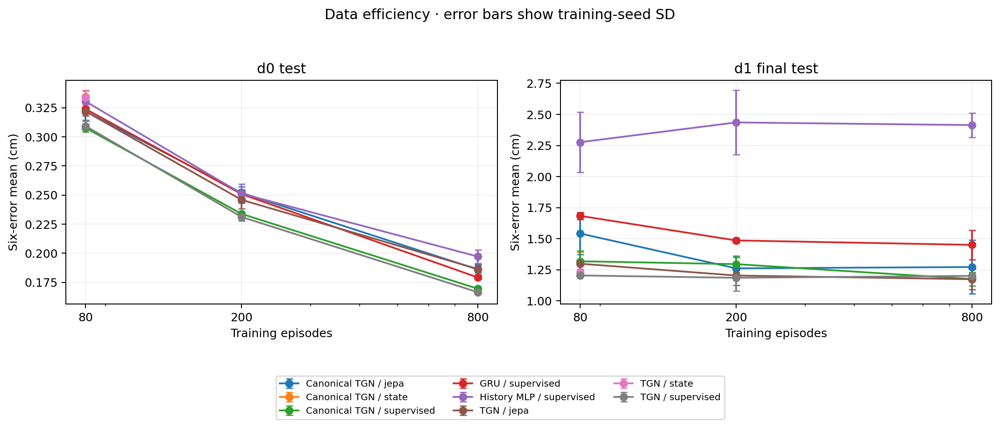
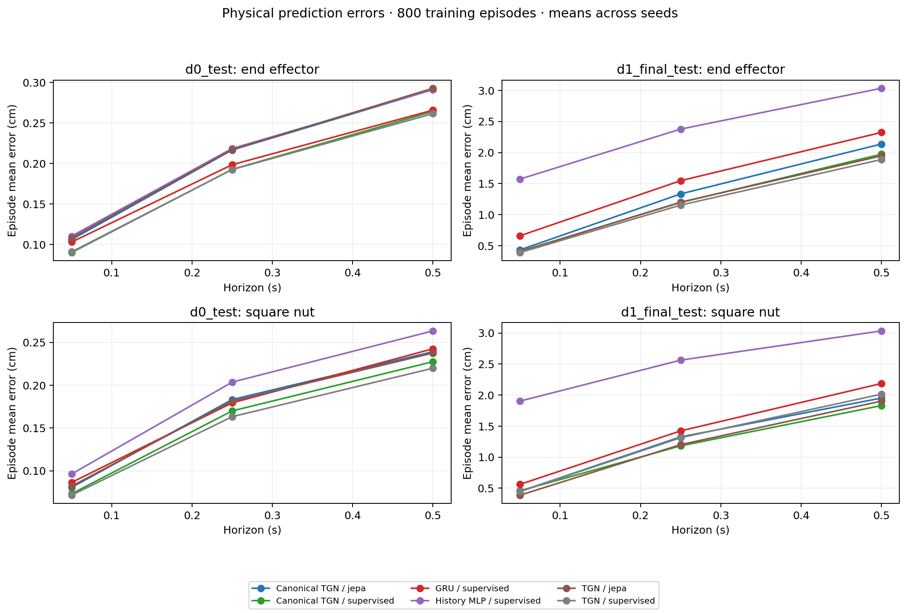
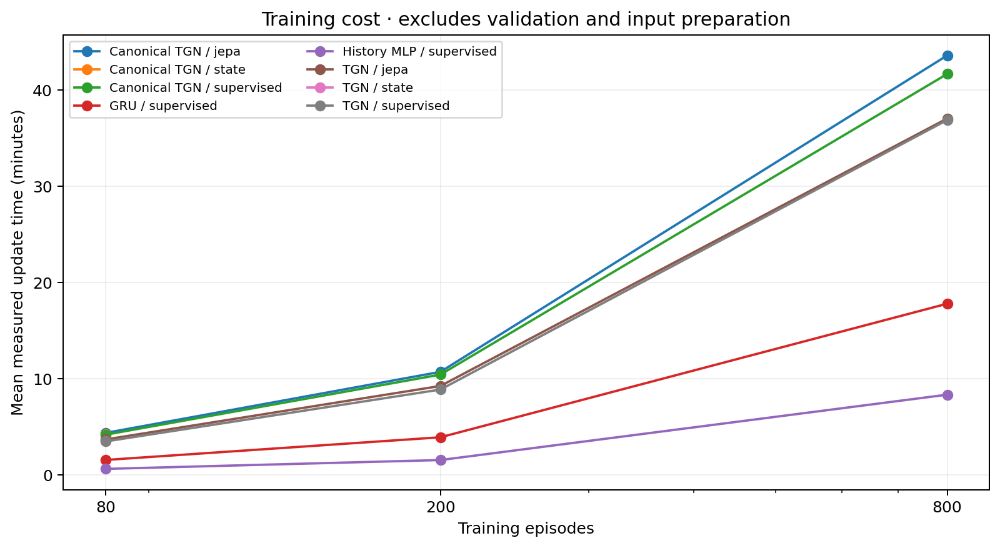

# Formal experiment results

Status: **complete**. 60 trained configurations; 124 evaluated prediction sets.

All mean errors are in cm. Smaller is better. SD describes training-seed variation, not an episode confidence interval.

| Split | Training episodes | Model | Method | Mean | Seed SD |
| --- | ---: | --- | --- | ---: | ---: |
| d0_test | 80 | canonical_temporal_gnn | jepa | 0.32191 | 0.00825 |
| d0_test | 80 | canonical_temporal_gnn | state | 0.33473 | 0.00454 |
| d0_test | 80 | canonical_temporal_gnn | supervised | 0.30770 | 0.00099 |
| d0_test | 80 | gru | supervised | 0.32394 | 0.00413 |
| d0_test | 80 | history_mlp | supervised | 0.33050 | 0.00228 |
| d0_test | 80 | temporal_gnn | jepa | 0.32188 | 0.00365 |
| d0_test | 80 | temporal_gnn | state | 0.33393 | 0.00607 |
| d0_test | 80 | temporal_gnn | supervised | 0.30931 | 0.00531 |
| d0_test | 200 | canonical_temporal_gnn | jepa | 0.25190 | 0.00502 |
| d0_test | 200 | canonical_temporal_gnn | supervised | 0.23380 | 0.00155 |
| d0_test | 200 | gru | supervised | 0.25080 | 0.00406 |
| d0_test | 200 | history_mlp | supervised | 0.25124 | 0.00823 |
| d0_test | 200 | temporal_gnn | jepa | 0.24588 | 0.00774 |
| d0_test | 200 | temporal_gnn | supervised | 0.23117 | 0.00342 |
| d0_test | 800 | canonical_temporal_gnn | jepa | 0.18610 | 0.00441 |
| d0_test | 800 | canonical_temporal_gnn | supervised | 0.16955 | 0.00067 |
| d0_test | 800 | gru | supervised | 0.17923 | 0.00146 |
| d0_test | 800 | history_mlp | supervised | 0.19719 | 0.00573 |
| d0_test | 800 | temporal_gnn | jepa | 0.18649 | 0.00306 |
| d0_test | 800 | temporal_gnn | supervised | 0.16654 | 0.00144 |
| d1_final_test | 80 | canonical_temporal_gnn | jepa | 1.54208 | 0.16849 |
| d1_final_test | 80 | canonical_temporal_gnn | state | 1.30330 | 0.08753 |
| d1_final_test | 80 | canonical_temporal_gnn | supervised | 1.31842 | 0.08451 |
| d1_final_test | 80 | gru | supervised | 1.68415 | 0.02880 |
| d1_final_test | 80 | history_mlp | supervised | 2.27639 | 0.24360 |
| d1_final_test | 80 | temporal_gnn | jepa | 1.29902 | 0.01088 |
| d1_final_test | 80 | temporal_gnn | state | 1.22899 | 0.02890 |
| d1_final_test | 80 | temporal_gnn | supervised | 1.20427 | 0.01256 |
| d1_final_test | 200 | canonical_temporal_gnn | jepa | 1.26165 | 0.08726 |
| d1_final_test | 200 | canonical_temporal_gnn | supervised | 1.29546 | 0.06506 |
| d1_final_test | 200 | gru | supervised | 1.48607 | 0.01990 |
| d1_final_test | 200 | history_mlp | supervised | 2.43542 | 0.25850 |
| d1_final_test | 200 | temporal_gnn | jepa | 1.20386 | 0.08069 |
| d1_final_test | 200 | temporal_gnn | supervised | 1.18565 | 0.10382 |
| d1_final_test | 800 | canonical_temporal_gnn | jepa | 1.27209 | 0.21581 |
| d1_final_test | 800 | canonical_temporal_gnn | supervised | 1.17543 | 0.05409 |
| d1_final_test | 800 | gru | supervised | 1.45047 | 0.11711 |
| d1_final_test | 800 | history_mlp | supervised | 2.41417 | 0.09685 |
| d1_final_test | 800 | temporal_gnn | jepa | 1.17398 | 0.08381 |
| d1_final_test | 800 | temporal_gnn | supervised | 1.20095 | 0.02267 |

See `analysis.json`, `groups.csv`, and `paired_contrasts.csv` for all seeds, motion/proximity groups, diagnostic flags, and paired differences. Negative differences favor the first method. All failed attempts remain in the queue log; no failed seed is omitted from a completed matrix.

D1 is a physical distribution shift; coordinate-transformation residuals are reported separately. Small proximity groups cannot establish contact-stage behavior. Findings from these tests are not a basis for retroactively retuning the frozen matrix.
