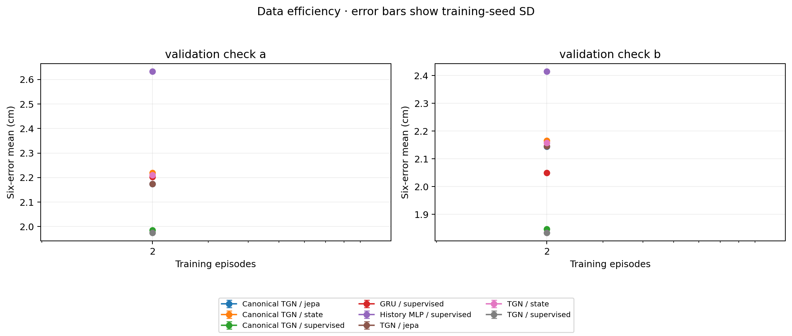
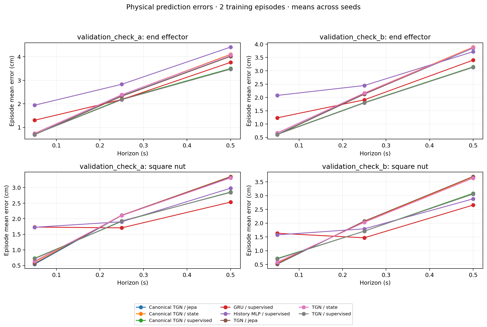
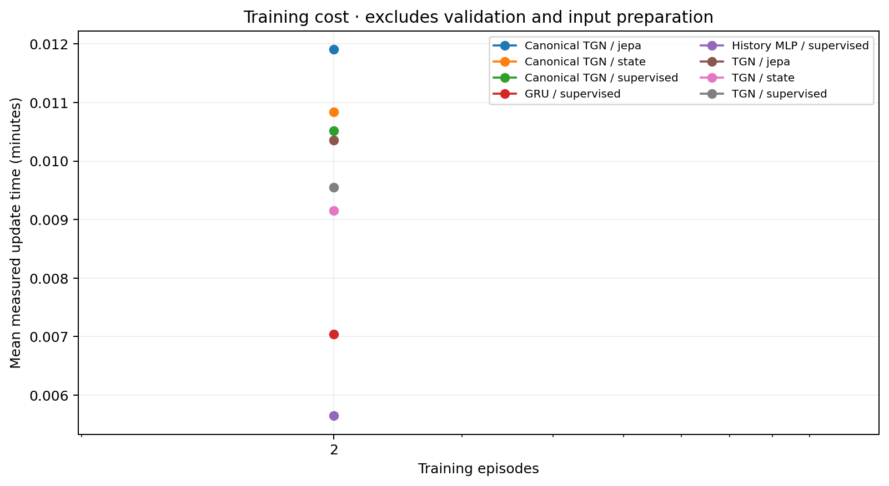

# Validation-only workflow check

This two-training-episode, single-seed check exercises the report pipeline. These are not formal test results.

Status: **complete**. 8 trained configurations; 20 evaluated prediction sets.

All mean errors are in cm. Smaller is better. SD describes training-seed variation, not an episode confidence interval.

| Split | Training episodes | Model | Method | Mean | Seed SD |
| --- | ---: | --- | --- | ---: | ---: |
| validation_check_a | 2 | canonical_temporal_gnn | jepa | 2.17358 | n/a |
| validation_check_a | 2 | canonical_temporal_gnn | state | 2.21970 | n/a |
| validation_check_a | 2 | canonical_temporal_gnn | supervised | 1.98501 | n/a |
| validation_check_a | 2 | gru | supervised | 2.20350 | n/a |
| validation_check_a | 2 | history_mlp | supervised | 2.63236 | n/a |
| validation_check_a | 2 | temporal_gnn | jepa | 2.17477 | n/a |
| validation_check_a | 2 | temporal_gnn | state | 2.20978 | n/a |
| validation_check_a | 2 | temporal_gnn | supervised | 1.97464 | n/a |
| validation_check_b | 2 | canonical_temporal_gnn | jepa | 2.14376 | n/a |
| validation_check_b | 2 | canonical_temporal_gnn | state | 2.16561 | n/a |
| validation_check_b | 2 | canonical_temporal_gnn | supervised | 1.84694 | n/a |
| validation_check_b | 2 | gru | supervised | 2.04992 | n/a |
| validation_check_b | 2 | history_mlp | supervised | 2.41434 | n/a |
| validation_check_b | 2 | temporal_gnn | jepa | 2.14631 | n/a |
| validation_check_b | 2 | temporal_gnn | state | 2.15801 | n/a |
| validation_check_b | 2 | temporal_gnn | supervised | 1.83341 | n/a |

See `analysis.json`, `groups.csv`, and `paired_contrasts.csv` for all seeds, motion/proximity groups, diagnostic flags, and paired differences. Negative differences favor the first method. All failed attempts remain in the queue log; no failed seed is omitted from a completed matrix.

D1 is a physical distribution shift; coordinate-transformation residuals are reported separately. Small proximity groups cannot establish contact-stage behavior. Findings from these tests are not a basis for retroactively retuning the frozen matrix.
