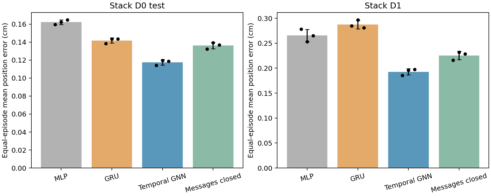
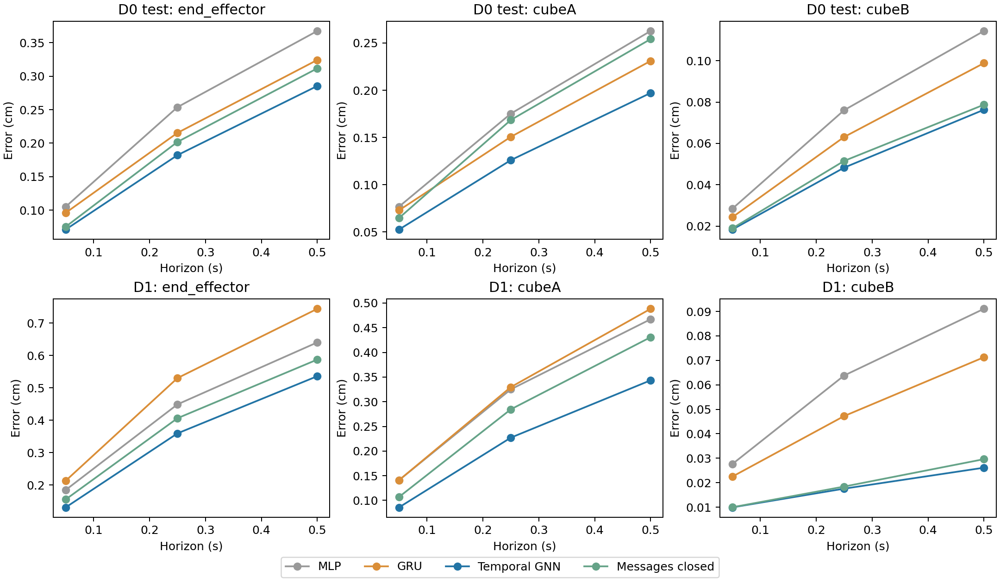

# Stack replication results

The Stack comparison is complete: four models across three seeds (12 trained configurations) and 28 evaluation sets. Supervised Temporal GNN improves the primary metric over MLP, GRU, and its message-ablation control on both test distributions, with the same direction in every seed. This replicates the supervised graph result on a second task; it does not test JEPA, equivariance, or transfer from Square.

GRAIL remains in scope; its separately frozen history-only forecasting experiment is described in the [launch record](grail/README.md). Results are pending. The Stack work is complete, but this report does not close that remaining Stage 9 item or start Stage 10.

## Main comparison

All learned models use 800 D0 training episodes, 100 validation episodes, and seeds 0/1/2. The held-out evaluation uses 100 D0 episodes and all 1,000 D1 episodes. One four-frame, planned-action-conditioned model handles 0.05/0.25/0.5 s horizons and predicts the end effector plus both cubes. Errors are Euclidean distances in cm; windows are averaged within episodes, then episodes and the nine entity/horizon cells receive equal weight. The static table is excluded.

| Model | D0 test, mean ± seed SD (cm) | D1, mean ± seed SD (cm) |
| --- | ---: | ---: |
| History MLP | 0.16223 ± 0.00260 | 0.26550 ± 0.01247 |
| GRU | 0.14186 ± 0.00297 | 0.28745 ± 0.00844 |
| Temporal GNN | 0.11750 ± 0.00297 | 0.19288 ± 0.00630 |
| Messages closed | 0.13619 ± 0.00340 | 0.22544 ± 0.00842 |

Relative to GRU, the GNN reduces error by **17.2% on D0 and 32.9% on D1**; relative to MLP, by **27.6% and 27.4%**. MLP is better than GRU on D1, so GRU is not the strongest non-graph control on that split. The GNN improves over both.



*Bars are means across three seeds, whiskers are sample seed SD, and dots are individual seeds. These whiskers are not confidence intervals.*

| Model | D0 seeds 0 / 1 / 2 (cm) | D1 seeds 0 / 1 / 2 (cm) |
| --- | --- | --- |
| History MLP | 0.15955 / 0.16243 / 0.16473 | 0.27814 / 0.25321 / 0.26515 |
| GRU | 0.13843 / 0.14345 / 0.14369 | 0.28457 / 0.29696 / 0.28083 |
| Temporal GNN | 0.11413 / 0.11975 / 0.11862 | 0.18567 / 0.19566 / 0.19732 |
| Messages closed | 0.13249 / 0.13918 / 0.13689 | 0.21586 / 0.23168 / 0.22878 |

## Paired comparisons and message ablation

Differences below are GNN minus the named control; negative favors GNN. The bootstrap jointly resamples seeds and shared episode IDs, with 2,000 draws and RNG seed 224. These are approximate intervals with only three training seeds and no multiple-comparison adjustment. Overlapping trajectory windows are not treated as independent samples.

| Split | Control | Mean difference (cm) | Paired 95% interval (cm) |
| --- | --- | ---: | --- |
| D0 test | History MLP | -0.04473 | [-0.05031, -0.03955] |
| D0 test | GRU | -0.02436 | [-0.02771, -0.02125] |
| D0 test | Messages closed | -0.01869 | [-0.02156, -0.01606] |
| D1 | History MLP | -0.07262 | [-0.09215, -0.05811] |
| D1 | GRU | -0.09457 | [-0.10381, -0.08390] |
| D1 | Messages closed | -0.03256 | [-0.03627, -0.02913] |

All six primary intervals exclude zero in the favorable direction, and all 18 paired seed differences are negative. Against the message-ablation control, the error reductions are **13.7% on D0 and 14.4% on D1**. Both variants have 125,379 nominal parameters, the same optimizer updates, and nearly equal measured update time.

This supports a benefit from learned neighbor exchange in the tested architecture. It does not attribute the entire graph-versus-GRU difference to messages: the message-closed model also beats MLP/GRU on the aggregate metric. It retains explicit relative-position features, per-node temporal processing, and shared prediction weights; disabled message parameters have no effective influence.

## Entities, horizons, and motion

GNN has lower seed-mean error than every learned control in all 18 entity/horizon cells. It also improves over MLP and GRU in all 54 predefined all/low-motion/moving cells. These are descriptive cell means, not 54 additional independent significance tests. Two cells reverse the message-ablation comparison: moving cube B in D1 at 0.05 s and 0.25 s, by +0.00021 and +0.00109 cm respectively.



*Each panel uses its own vertical scale. Curves show means across seeds; all seed values and group counts are in [groups.csv](formal/analysis/groups.csv).*

Each table entry below lists 0.05 / 0.25 / 0.5 s errors in cm.

| Split | Entity | GNN | GRU | Messages closed |
| --- | --- | --- | --- | --- |
| D0 test | end_effector | 0.0713 / 0.1822 / 0.2853 | 0.0962 / 0.2155 / 0.3241 | 0.0755 / 0.2020 / 0.3116 |
| D0 test | cubeA | 0.0526 / 0.1260 / 0.1971 | 0.0729 / 0.1507 / 0.2310 | 0.0648 / 0.1686 / 0.2542 |
| D0 test | cubeB | 0.0184 / 0.0483 / 0.0763 | 0.0243 / 0.0631 / 0.0988 | 0.0190 / 0.0516 / 0.0787 |
| D1 | end_effector | 0.1307 / 0.3594 / 0.5359 | 0.2129 / 0.5302 / 0.7440 | 0.1552 / 0.4062 / 0.5872 |
| D1 | cubeA | 0.0859 / 0.2272 / 0.3434 | 0.1410 / 0.3297 / 0.4883 | 0.1070 / 0.2846 / 0.4307 |
| D1 | cubeB | 0.0099 / 0.0176 / 0.0261 | 0.0225 / 0.0472 / 0.0713 | 0.0100 / 0.0184 / 0.0296 |

The moving-cube-A result survives the aggregate breakdown: at 0.5 s in D1, GNN/GRU/messages-closed errors are 0.4860/0.6722/0.6169 cm. Group membership uses only the speed from the preceding state transition. The training 25th-percentile thresholds, floored at 1e-6 m/s, are 0.0679462 m/s for the end effector and 1e-6 m/s for each cube. These are motion labels, not contact or grasp labels.

| Split | Entity | Segment at 0.5 s | Episodes / windows | GNN (cm) | GRU (cm) | Messages closed (cm) |
| --- | --- | --- | ---: | ---: | ---: | ---: |
| D0 test | end_effector | low_motion | 100 / 1962 | 0.30715 | 0.33767 | 0.31919 |
| D0 test | end_effector | moving | 100 / 7670 | 0.27876 | 0.32014 | 0.30962 |
| D0 test | cubeA | low_motion | 100 / 3913 | 0.08568 | 0.11703 | 0.09582 |
| D0 test | cubeA | moving | 100 / 5719 | 0.27192 | 0.30686 | 0.36064 |
| D0 test | cubeB | low_motion | 100 / 6917 | 0.03231 | 0.05971 | 0.03609 |
| D0 test | cubeB | moving | 100 / 2715 | 0.09847 | 0.11395 | 0.09895 |
| D1 | end_effector | low_motion | 1000 / 17357 | 0.50249 | 0.73349 | 0.54270 |
| D1 | end_effector | moving | 1000 / 77876 | 0.54212 | 0.74463 | 0.59593 |
| D1 | cubeA | low_motion | 1000 / 38366 | 0.12491 | 0.21014 | 0.14058 |
| D1 | cubeA | moving | 1000 / 56867 | 0.48596 | 0.67221 | 0.61693 |
| D1 | cubeB | low_motion | 1000 / 78306 | 0.02229 | 0.07082 | 0.02656 |
| D1 | cubeB | moving | 1000 / 16927 | 0.03441 | 0.06198 | 0.03562 |

## Simple baselines and limits

| Baseline | D0 nine-error mean (cm) | D1 nine-error mean (cm) |
| --- | ---: | ---: |
| Position hold | 1.64810 | 1.98639 |
| Constant velocity | 1.37340 | 1.41476 |

**Holding position beats the learned models on cube B at every horizon in both distributions.** At 0.5 s, hold versus GNN is 0.07258 versus 0.07628 cm on D0 and 0.01363 versus 0.02613 cm on D1. Constant velocity also beats GNN on cube B at the shortest horizon. Thus the graph result is not a universal victory over simple physical priors. The learned models receive planned actions; the two non-learning baselines ignore them.

D1 is harder on the overall metric (GNN error is 1.64 times D0), but not on every entity. Cube B has lower errors in D1; only 17.8% of its eligible 0.5 s windows are in the moving group, versus 28.2% in D0. This distribution shift should not be summarized as uniformly harder motion.

The two-task evidence supports supervised graph prediction under these inputs and budgets. Square averages six entity/horizon cells and Stack averages nine, so their absolute scores should not be pooled. Neither result proves universal graph superiority, a contact-specific benefit, or improved closed-loop control. Stack did not test JEPA or canonicalization and therefore does not change their mixed/negative Square findings. Demonstration ancestry is unavailable, so episode splitting and exact trajectory hashes cannot rule out shared source-demonstration dependencies.

## Cost and reliability

Training and independent validation reloads completed in **3 h 50 min 15 s**, with no failures or retries. Each model received 40 epochs and 37,240 optimizer updates. Best epochs ranged from 33 to 40; two of the twelve runs selected epoch 40. These are fixed-budget comparisons, not claims about fully converged or optimally tuned models.

| Model | Parameters | Mean update time per run (min) |
| --- | ---: | ---: |
| History MLP | 133,769 | 6.42 |
| GRU | 125,257 | 13.52 |
| Temporal GNN | 125,379 | 27.21 |
| Messages closed | 125,379 | 27.08 |

GNN and GRU differ by only 122 parameters (about 0.1%), but GNN used about twice the update time. The full matrix used 3.71 h of optimizer updates; the rest was loading, validation, checkpointing, and independent reloads. Peak sampled RSS was 2.20 GiB and peak allocated CUDA memory 1.04 GiB.

All 12 runs were checked against the frozen matrix, training split, normalizer, historical/current training source hashes, and selected-checkpoint seal before test access. Every checkpoint independently reproduced its validation predictions. Held-out errors use decoded predictions against raw physical position deltas; checkpoint selection remains the original validation rule.

The [offline verification](offline_verification.json) checks all 28 compressed episode-file hashes, independently recomputes 756 group means/counts, and reproduces summary tables, paired intervals, and costs exactly on Windows. Both final figures were inspected. The Linux suite passes 56 tests; Windows passes 32 with 10 skip entries for unavailable torch/PyG coverage. Independent full error-array rechecks passed for ordinary GNN seed 0 and messages-closed seed 2 on both D0 and D1: all four error hashes, summaries, and episode IDs match exactly. The [final audit](final_verification.json) records complete coverage and test access after sealing; the [final tests](final_tests.txt), [lint](final_ruff.txt), and [formatting](final_format.txt) also pass. No training or evaluation job remains running; the AutoDL instance was not shut down.

## Artifacts and reproduction

- [Summary](formal/analysis/summary.csv), [paired intervals](formal/analysis/paired_contrasts.csv), [groups](formal/analysis/groups.csv), [costs](formal/analysis/costs.csv), and [analysis JSON](formal/analysis/analysis.json).
- [Frozen matrix](formal/matrix.json), [training progress](formal/progress.json), [selection seal](formal/selection_seal.json), and [test-access audit](formal/evaluation/access.json).
- All 12 configurations, metrics, normalizers, logs, and validation reload records are under [formal/](formal/). All 28 test JSON files and losslessly compressed episode-error CSVs are under [evaluation/](formal/evaluation/). Raw states and weights are not committed.
- [Data/source audit and launch](launch.md), [split manifest](cache/manifest.json), [simulator restoration](restoration.json), and [preflight checks](preflight/checks.json).

Training launched at `34abd1e`; subsequent documentation-only updates produced `8c93daf`, recorded by the final training metrics. Evaluation and original analysis used clean commit `cb319f8`; the training implementation was not changed. Checkpoints remain on AutoDL in `outputs/stage9/formal/<run_id>/{best,last}.pt`.

Recompute all tables and figures on CPU using only committed results (choose a fresh output directory):

```bash
python -m robot_dynamics.analyze_stack --runs reports/stage9/formal --output outputs/stack_reanalysis
```

On AutoDL, from `/root/autodl-tmp/RobotDynamics-CS224W-Stanford`, the evaluated sealed checkpoints can be checked again without training:

```bash
.venv/bin/python -m robot_dynamics.evaluate_stack outputs/stage9/cache/stack_d0.hdf5 --d1-cache outputs/stage9/cache/stack_d1.hdf5 --manifest outputs/stage9/cache/manifest.json --runs outputs/stage9/formal --verify-run temporal_gnn_s0
```

The [Stack protocol](../../docs/stack_protocol.md) records the experiment scope; the [archived launch record](launch.md) retains data-preparation and recovery commands. Both Stack test distributions are now used tests; any new test-inspired work is exploratory. The separate GRAIL experiment remains open, and Stage 10 has not started.
