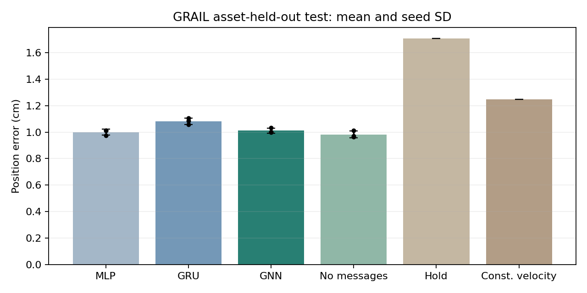
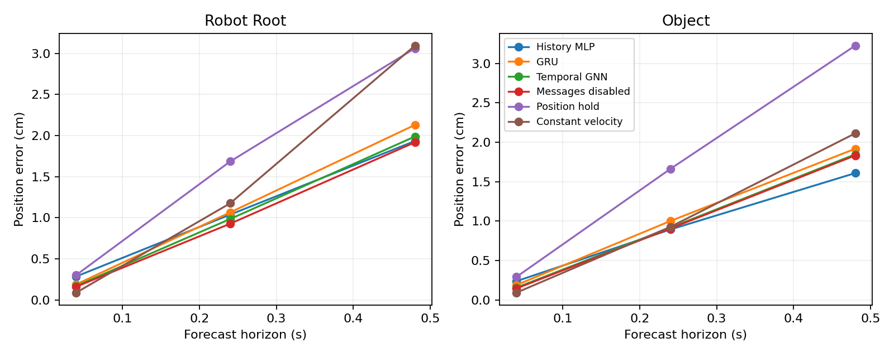
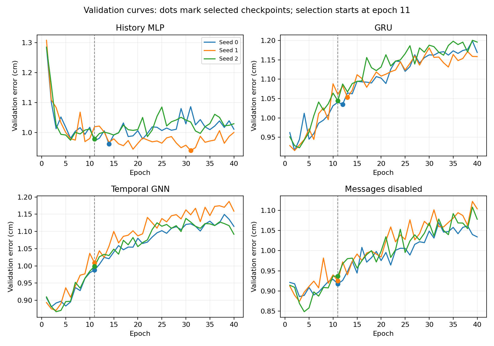
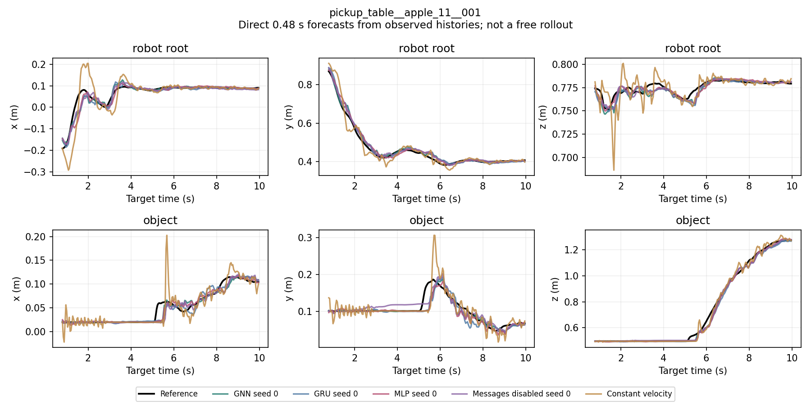
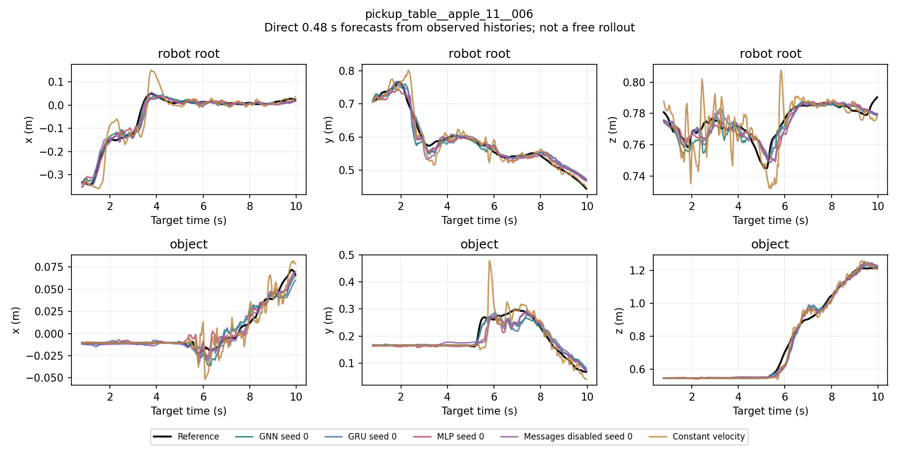
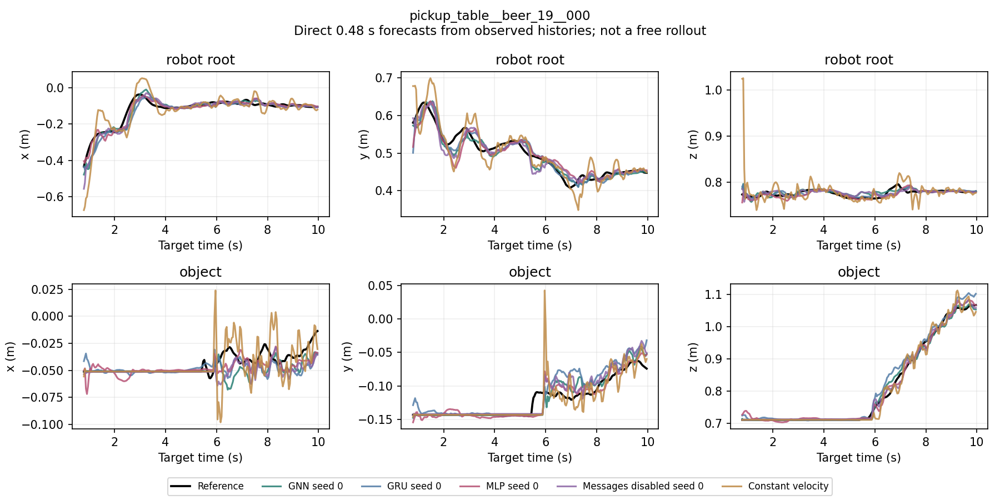
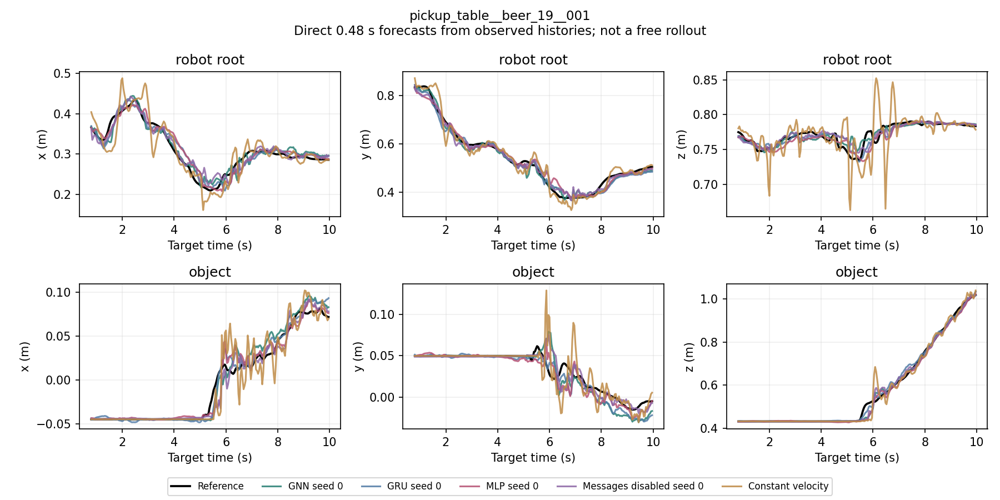

# GRAIL pickup forecasting results

The 12-run experiment is complete. Temporal GNN improves over GRU by **6.6%**, but does not improve over the history MLP or the messages-disabled control. This task therefore does not reproduce the message-passing benefit found on Stack. All runs and seeds are retained, including the negative comparisons.

This is a history-only numeric and trajectory demonstration on G1 pickup motions, trained from scratch. It does not transfer Square/Stack weights, simulate the robot, measure pickup success, or evaluate closed-loop control. Stage 9 is ready for review; Stage 10 has not started.

## Data and comparison

The [frozen protocol](../../../docs/grail_protocol.md) and [configuration](../../../configs/grail_protocol.yaml) specify 240 motions from 120 assets, two motions per asset. The asset-disjoint split contains 168 training, 36 validation and 36 test motions (84/18/18 assets). All normalization and motion thresholds use training data only. Inputs contain eight observed frames, spanning 0.28 s, and a horizon indicator. The three graph nodes are robot root, object and table; the targets are root and object positions at 0.04/0.24/0.48 s. No future action or state enters the history.

The primary score averages physical Euclidean position error in cm across motions, two entities and three horizons; lower is better. Equal motion and asset weighting coincide because each asset has two motions. The static table is excluded. These scores are a separate task and should not be pooled with the action-conditioned Square/Stack metrics.

## Held-out results

| Model | Seed 0 | Seed 1 | Seed 2 | Mean ± seed SD, cm |
| --- | --- | --- | --- | --- |
| History MLP | 1.0108 | 0.9759 | 1.0135 | 1.0001 ± 0.0209 |
| GRU | 1.0573 | 1.1055 | 1.0847 | 1.0825 ± 0.0242 |
| Temporal GNN | 1.0014 | 0.9986 | 1.0327 | 1.0109 ± 0.0189 |
| Messages disabled | 0.9711 | 0.9629 | 1.0130 | 0.9823 ± 0.0269 |
| Position hold | — | — | — | 1.7052 |
| Constant velocity | — | — | — | 1.2488 |

All four learned models beat position hold and constant velocity on the aggregate score. GNN is 1.1% worse than MLP and 2.9% worse than messages disabled on the mean. All three seeds favor GNN over GRU, and all three favor messages disabled over GNN. The small MLP/ablation differences remain uncertain across held-out assets.



| GNN minus control | Difference, cm | 95% joint seed/asset interval, cm |
| --- | --- | --- |
| History MLP | +0.0108 | [-0.0319, +0.0485] |
| GRU | -0.0716 | [-0.1114, -0.0299] |
| Messages disabled | +0.0286 | [-0.0025, +0.0576] |

Negative differences favor GNN. These are the three predeclared contrasts, with 2,000 paired joint seed/asset bootstrap draws and bootstrap seed 224. With only three training seeds and 18 test assets, the intervals are descriptive, without multiple-comparison adjustment. The GRU interval excludes zero; the MLP and messages-disabled intervals do not. They support a benefit over this GRU configuration, not a general benefit from message passing or conclusive inferiority to the other controls.

## Entities, horizons and motion groups

Each entry below is the mean across training seeds, in cm; baseline values are deterministic. Population counts apply to each model and seed. Full seed SDs and counts are retained in [analysis.json](formal/analysis/analysis.json) and the compressed [group table](formal/analysis/groups.csv.gz).

| Entity | Group | Horizon, s | Motions/assets/windows | History MLP | GRU | Temporal GNN | Messages disabled | Position hold | Constant velocity |
| --- | --- | --- | --- | --- | --- | --- | --- | --- | --- |
| robot_root | all | 0.04 | 36/18/8676 | 0.2864 | 0.1904 | 0.1709 | 0.1619 | 0.3034 | 0.0896 |
| robot_root | all | 0.24 | 36/18/8496 | 1.0386 | 1.0660 | 0.9852 | 0.9280 | 1.6849 | 1.1762 |
| robot_root | all | 0.48 | 36/18/8280 | 1.9338 | 2.1295 | 1.9885 | 1.9180 | 3.0619 | 3.0937 |
| object | all | 0.04 | 36/18/8676 | 0.2387 | 0.1899 | 0.1567 | 0.1465 | 0.2932 | 0.0930 |
| object | all | 0.24 | 36/18/8496 | 0.8943 | 1.0019 | 0.9174 | 0.9069 | 1.6629 | 0.9277 |
| object | all | 0.48 | 36/18/8280 | 1.6087 | 1.9173 | 1.8466 | 1.8325 | 3.2252 | 2.1130 |

GNN beats GRU in all six aggregate entity/horizon cells, while messages disabled beats GNN in all six. Constant velocity wins at the shortest horizon for both entities. MLP has the best 0.48 s learned-model errors for both entities and the best object error at 0.24 s.



The groups below use each anchor's backward-difference speed and the training-frame 25th percentile thresholds. The thresholds are 0.0260521 m/s for the root and 0.00000149012 m/s for the object, so the object low-motion group is essentially stationary. They describe current motion, not labeled contact or pickup phases. Only motions containing the group contribute to its episode mean; grouped means therefore do not combine by simply averaging them.

| Entity | Group | Horizon, s | Motions/assets/windows | History MLP | GRU | Temporal GNN | Messages disabled | Position hold | Constant velocity |
| --- | --- | --- | --- | --- | --- | --- | --- | --- | --- |
| robot_root | low_motion | 0.04 | 36/18/2588 | 0.2156 | 0.1422 | 0.1041 | 0.1002 | 0.0709 | 0.0424 |
| robot_root | low_motion | 0.24 | 36/18/2455 | 0.5767 | 0.6420 | 0.5590 | 0.5193 | 0.5108 | 0.4809 |
| robot_root | low_motion | 0.48 | 36/18/2305 | 1.0868 | 1.2464 | 1.1207 | 1.0843 | 1.1068 | 1.1886 |
| robot_root | moving | 0.04 | 36/18/6088 | 0.3160 | 0.2104 | 0.2001 | 0.1871 | 0.4036 | 0.1094 |
| robot_root | moving | 0.24 | 36/18/6041 | 1.2367 | 1.2421 | 1.1655 | 1.0937 | 2.1837 | 1.4676 |
| robot_root | moving | 0.48 | 36/18/5975 | 2.2866 | 2.4828 | 2.3406 | 2.2499 | 3.8702 | 3.8691 |
| object | low_motion | 0.04 | 28/15/1805 | 0.1483 | 0.0946 | 0.0569 | 0.0615 | 0.0009 | 0.0009 |
| object | low_motion | 0.24 | 28/15/1805 | 0.2752 | 0.3032 | 0.2264 | 0.2845 | 0.0404 | 0.0404 |
| object | low_motion | 0.48 | 28/15/1805 | 0.5569 | 0.7127 | 0.6526 | 0.7974 | 0.1908 | 0.1909 |
| object | moving | 0.04 | 36/18/6871 | 0.2703 | 0.2229 | 0.1921 | 0.1760 | 0.3883 | 0.1228 |
| object | moving | 0.24 | 36/18/6691 | 1.1037 | 1.2538 | 1.1748 | 1.1342 | 2.2072 | 1.2133 |
| object | moving | 0.48 | 36/18/6475 | 1.9811 | 2.3924 | 2.3447 | 2.2647 | 4.2930 | 2.7540 |

The subgroup exception is low-motion objects: GNN beats messages disabled at all three horizons there, but position hold and constant velocity both beat all learned models. On moving objects, messages disabled wins over GNN at every horizon. Thus the low-motion exception does not establish an overall message benefit.

## Training behavior and cost

Training and its independent validation reloads took **56 min 47 s** on the 48 GB RTX 4090 D server. There were 12 starts, 12 successful reloads, no resumed or failed runs, and no discarded seeds. Each run completed 40 epochs and 9,280 optimizer updates. The table reports update time separately from validation, reload and I/O overhead; GPU memory is PyTorch peak allocated memory, not total device usage.

| Model | Parameters | Selected epoch (seeds 0/1/2) | Mean update minutes/run | Peak allocated CUDA GiB |
| --- | --- | --- | --- | --- |
| History MLP | 119206 | 14, 31, 11 | 0.96 | 1.04 |
| GRU | 129606 | 12, 13, 11 | 3.88 | 1.04 |
| Temporal GNN | 119427 | 11, 11, 11 | 6.61 | 1.52 |
| Messages disabled | 119427 | 11, 11, 11 | 6.53 | 1.52 |

GNN costs about 1.71 times GRU's update time. The graph and disabled-message control have the same nominal parameter count and similar update time; disabled messages are computed and zeroed, so their parameters do not influence predictions. This controls message use, not the number of effectively trainable parameters.



All six graph configurations selected epoch 11, the earliest epoch allowed by the frozen 11–40 selection window. Their validation minima over all epochs occurred earlier, and later validation errors rose despite continued training-loss reduction. GRU shows a similar early deterioration. This limits the conclusion to the fixed training recipe; it is not an architecture-specific tuning comparison. We retain the predeclared rule and do not replace checkpoints after seeing test results. Earlier checkpoint selection would be a new experiment, and these curves do not establish that it would restore a message-passing advantage.

## Predetermined trajectory examples

These are all four motions belonging to the first two sorted test assets, `apple_11` and `beer_19`. Selection was fixed before test evaluation. The figures include all four learned models at seed 0 and constant velocity. Position hold is retained in the numerical evaluations and trajectory CSVs but omitted from these crowded plots. Each point is a direct 0.48 s forecast from an observed history, aligned at target time; the lines are not autoregressive rollouts.









The apple examples show lag around abrupt object motion; constant velocity has visible overshoots. These displays illustrate errors rather than successful robot execution. The coarse root/object/table graph omits wrist Cartesian anchors, mesh geometry and contact labels, which limits what its messages can represent. No causal attribution of the negative result to any one of these choices has been tested.

## Verification and reproduction

The [final audit](final_verification.json) verifies that all 12 checkpoint selections were sealed before test access, and that code, data, split and normalizer identities match. Evaluation covers 14 sets: 12 learned-model runs and two non-learning controls on all 36 test motions. It repeats full validation reloads for all 12 runs and independently reproduces full held-out error arrays for GNN seed 0 and messages-disabled seed 2. Both rechecks match exactly. The [Linux suite](final_tests.txt) passes 62 tests.

The [offline verification](offline_verification.json) checks all 14 compressed episode-file hashes and independently recomputes 252 group means and population counts. Windows reanalysis exactly reproduces numerical summaries, paired intervals, costs and all 480 training-curve rows. All seven final figures were visually inspected. The Windows suite passes 36 tests with 11 skip entries for unavailable torch/PyG coverage; Linux covers those dependencies. [Lint](final_ruff.txt) and [formatting](final_format.txt) checks pass. CSVs are losslessly gzip-compressed; the analyzer reads them directly. Raw data and checkpoints remain outside git on AutoDL; this report archive supports numerical reanalysis without them, while prediction replay needs the cache and checkpoint files.

Training source: `ef13ad69315c9b3adf67153ab431a0e7eb84b6f4` (later launch documentation did not change training code). Evaluation source: `b9ff03cbc85c5ebba2b3688d7864a259fc48221b`. The final analysis source is recorded in [analysis.json](formal/analysis/analysis.json). See the [manifest](manifest.json), [data audit](data_audit.json), [matrix](formal/matrix.json), [selection seal](formal/selection_seal.json), [evaluation inventory](formal/evaluation/complete.json), and [archived launch commands](launch.md).

Offline reproduction from the repository root, using the base project environment:

```bash
python -m robot_dynamics.analyze_grail \
  --runs reports/stage9/grail/formal \
  --manifest reports/stage9/grail/manifest.json \
  --output outputs/grail/reanalysis
```

Prediction replay on the original AutoDL cache and completed training directory:

```bash
.venv/bin/python -m robot_dynamics.evaluate_grail outputs/grail/cache.h5 \
  --manifest outputs/grail/manifest.json --runs outputs/grail/formal \
  --recheck temporal_gnn_s0 temporal_no_messages_s2
```

The GRAIL test split is now a used test set. Future changes motivated by these results must be labeled exploratory. Together with Square and Stack, the evidence supports supervised graph prediction under the tested manipulation setups, with a clear boundary: the benefit does not carry over uniformly to this history-only GRAIL task. There is no additional JEPA, equivariance, transfer or closed-loop claim here. The final [process check](process_check.json) found no GRAIL training/evaluation job or GPU compute process; the server has not been shut down.
