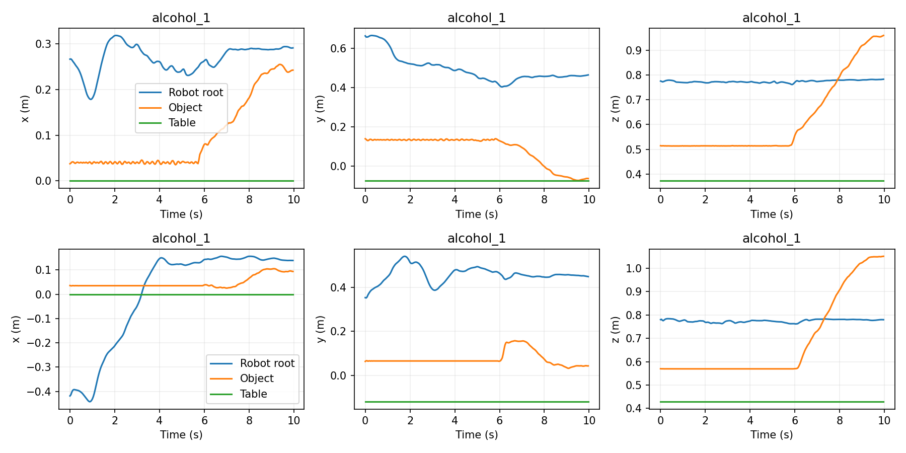

# GRAIL launch record

This is the archived launch snapshot. Training and evaluation have since completed; see the [results](README.md).

The pickup demonstration is a separate part of Stage 9. Its scope is now fixed: history-only forecasting from scratch on 240 tabletop pickup motions, with four models and three seeds. The 12-run driver is now training on the new 48 GB AutoDL server and survives SSH disconnection. The [migration record](migration_48gb/README.md) contains CUDA checks, resource measurements and the active queue details. The original server's waiting queue has been stopped. No held-out GRAIL result is available yet. The completed [Stack report](../README.md) remains unchanged as evidence about that task.

See the [protocol](../../../docs/grail_protocol.md), [configuration](../../../configs/grail_protocol.yaml), [asset-disjoint manifest](manifest.json), and [data audit](data_audit.json). All 720 downloaded files passed their pinned upstream hashes. The 240 trajectories contain 60,000 frames; 218 source keys stay within their asset split. No exact numerical duplicates or invalid fields were found. The audit is a release-format and numerical check, not a physics replay or confirmation that every pickup succeeds.



The rows show the first two sorted training motions. The position traces were inspected for plausible alignment and motion; the figure does not verify contacts or controller behavior.

## Reproduce preparation

Use the existing Linux CUDA environment from the project setup, then add the file reader:

```bash
.venv/bin/python -m pip install -r requirements/grail.txt
.venv/bin/python -u -m robot_dynamics.prepare_grail \
  --raw outputs/grail/raw --output outputs/grail/prepared
```

The downloader is pinned to the recorded revision. The default endpoint is Hugging Face; `--endpoint https://hf-mirror.com` can retrieve the same hash-verified files where the main endpoint is inaccessible. The current AutoDL launch uses the identical cache prepared locally because the main Hugging Face endpoint timed out on that server. The source records and original files remain locally available.

## Train or resume on AutoDL

From `/root/autodl-tmp/RobotDynamics-CS224W-Stanford`, the deployed cache and manifest are `outputs/grail/cache.h5` and `outputs/grail/manifest.json`:

```bash
mkdir -p outputs/grail/formal
nohup setsid bash scripts/run_grail.sh \
  outputs/grail/cache.h5 outputs/grail/manifest.json outputs/grail/formal \
  > outputs/grail/formal/driver.log 2>&1 < /dev/null &
```

Use the same command after an interruption; the locks prevent a duplicate active queue. It resumes from the last completed epoch, checks finished runs, and continues remaining seeds. Do not modify the training files or data mid-queue.

```bash
cat outputs/grail/formal/progress.json
tail -n 30 outputs/grail/formal/driver.log
cat outputs/grail/formal/training.exit
```

`training.exit` is absent while the driver runs; zero plus `status: training_complete` and a 12-run `selection_seal.json` indicates successful completion. A failed process leaves its error and nonzero exit code. `waiting_for_gpu` means the queue is alive but another GPU job is still running. Logs are per run; checkpoints, normalizers and metrics are under the named model/seed directory. The training process does not evaluate test predictions or shut down the instance.

After training, verify all 12 configurations, logs, checkpoints and seals, then evaluate the reserved test assets, both non-learning baselines, grouped errors and trajectory displays. No test score or transfer claim should be inferred from the launch checks.

## Original server launch checks (archived)

Source commit: `51a9a78021c56df202add86b19a745496bed4917`. The [post-disconnection check](launch_verification.json) confirms driver PID 347386, parent PID 1, an independent session, ignored SIGHUP and `/dev/null` input. Its runner child is PID 347391. A duplicate launch exited with code 1 before touching the active job. The recorded status is `waiting_for_gpu`, because pre-existing PID 339111 occupies about 20.7 GB of the GPU. The queue checks every 30 seconds and starts automatically when the GPU is free; that process was not interrupted. There is no runtime cap or automatic instance shutdown.

The Linux [test log](checks/tests.txt) records 60 passing tests; [Ruff](checks/ruff.txt) and shell syntax checks pass. Local base-only checks pass 34 tests and skip 11 torch-dependent modules/tests. The four real-data CPU checks each pass independent validation reload and uninterrupted-versus-resumed training comparisons. In the final check all four parameter sets and selected-prediction hashes match exactly. An earlier MLP attempt had a maximum parameter difference of 2.78e-7; recovery is therefore tested with explicit `rtol=1e-5, atol=1e-6` and validation-score drift below 1e-4 cm, rather than promising bitwise equality on every CPU invocation. No training code was changed to obtain the repeated result.

The two-motion GNN fitting check reduced training MSE to 0.158966 of its initial value. These are implementation checks, not test results. The [check summary](checks/workflow_check_numerical/checks.json) and its logs retain the actual numbers. A separate [complete queue check](checks/queue_check/progress.json) trained and reloaded all four models at a one-epoch CPU smoke budget, sealed four checkpoints and exited zero. It used the committed source. The [source verification](checks/source_verification.json) confirms the precommit training check differs from that source only in `train_grail.py` line endings; data and the published manifest match exactly.

At this original launch, the GRAIL CUDA training path had not yet been measured because the GPU was occupied. The later [48 GB migration](migration_48gb/README.md) completes those checks and starts formal training. CPU tests, complete queue execution, data integrity and detached waiting are verified. Once the GPU is released, any CUDA or training error stops the queue visibly with logs and a nonzero exit code; no model or seed is silently dropped. SSH logout is covered by the survival check, but server shutdown, storage failure and externally sent kill signals cannot be prevented by `nohup`. Every completed epoch is recoverable with the same launch command.

To rerun the real-data CPU checks in a new output directory:

```bash
.venv/bin/python -m scripts.check_grail outputs/grail/cache.h5 \
  --manifest outputs/grail/manifest.json --output outputs/grail/check_again
```
